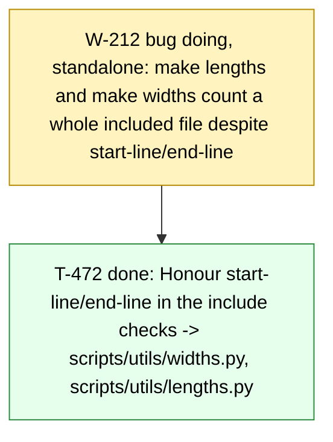

# Board -- chaos-to-simple
record: local
open path: W-212   | blocked: 0 | todo roots: 0 | done: 693 | pruned: 9

## Tree

```text
W-212  bug    [doing]    (standalone) make lengths and make widths count a whole included file despite start-line/end-line   (filed during T-470) -- T-472 [done]
```

## Closed

### E-001 [done] Deck infrastructure: the drafts become one beamer PDF through make

closed 2026-10-30 -- outcome: make check proves the repository (board, ruff, pyright, pytest, ascii) and make deliverable writes build/talk.pdf from 00-frontmatter..07-close with every snippet, artifact and diagram built by make. -- ledger: ledgers/E-001.md

#### W-001 issue [done] The front door: base Makefile, python layer and the 3.14 toolchain

- T-001 [done] Write the base Makefile, the python layer and the 3.14 toolchain files -> make check prints [DONE] all checks passed
- T-002 [done] Move the helper tests beside their modules under the one-assert conftest -> make test M=model K=test_bars_follow_the_inventory passes

#### W-002 issue [done] The deck builds: mk/deck.mk, lualatex and the installed fonts

- T-003 [done] Add the diagram fallback helper scripts/utils/diagram.py with its edge test -> make test M=edge K=test_write_placeholder passes
- T-004 [done] Add mk/deck.mk with the deck targets, lualatex and the installed fonts -> make deliverable prints [DONE] deliverables built: deliverable-talk
- T-005 [done] Rewrite the README build section and add CLAUDE.md with the gate deviations -> grep finds ## Gate deviations in CLAUDE.md

### E-002 [done] The deck tells the storyline: past me, the cast of the ifs, three incidents closed by name

closed 2026-10-30 -- outcome: make talk builds a deck that runs from the message of past me to the six lines, with the cast, the incidents, the counts and the lines as artifacts the build measures or checks. -- ledger: ledgers/E-002.md

#### W-007 issue [done] 01-bits: the protagonist, the cast of the ifs and the count to 64

- T-010 [done] Add the cast data and its renderer -> build/01-bits/cast.txt
- T-011 [done] Rewrite the exhibit as past me left it -> test_chaos.py with his names, the I1 report
- T-012 [done] Add the two-ifs zoom-in -> build/01-bits/two_ifs.txt
- T-013 [done] Rewrite the 01 slides to the nine-slide format -> 01-bits/index.md, nine slides

#### W-008 issue [done] 00-frontmatter: the message from past me and the route

- T-014 [done] Draw the route -> build/00-frontmatter/route.png in the deck style
- T-015 [done] Rewrite the opening -> 00-frontmatter/index.md: message, raw code, chat, route

#### W-009 issue [done] 02-stacey: which problem do I have

- T-016 [done] Rewrite the 02 slides -> 02-stacey/index.md: instinct, matrix, map, route, the line

#### W-010 issue [done] 03-chaos: the room, the dispute decided and the honest count

- T-017 [done] Rewrite the red cards -> 03-chaos/data/questions.md with question 3 decided
- T-018 [done] Rewrite the 03 slides -> 03-chaos/index.md: room, six questions, effects, 512, table, line

#### W-011 issue [done] 04-what: the words become homes

- T-019 [done] Render the contexts with their faces -> build/04-what/contexts.txt
- T-020 [done] Rewrite the 04 slides -> 04-what/index.md: the sentence, homes with faces, the line

#### W-012 issue [done] 05-how: I3, the false victory and the seam

- T-021 [done] Write the I3 report -> 05-how/data/incident.txt
- T-022 [done] Rewrite the 05 slides -> 05-how/index.md: I3, the class, the hidden bit, CQS, seam, line

#### W-013 issue [done] 06-simple: the run of 72 and the seventh if

- T-023 [done] Add the seventh if beside the core, not inside it -> 06-simple/s06_simple/seventh.py
- T-028 [done] Render the epilogue counts -> build/06-simple/epilogue.txt
- T-029 [done] Rewrite the 06 slides -> 06-simple/index.md: core, 64, the wounds, 72, epilogue, line

#### W-014 issue [done] 07-close: the six lines

- T-024 [done] Rewrite the close -> 07-close/index.md: the six lines, where to go, Q&A
- T-025 [done] Check the lines against the sections -> scripts/check_lines.py, make lines

#### W-015 issue [done] build: the targets and filter behaviour the checks assume

- T-026 [done] Rename slides to talk, add K= to test, add the lines target -> Makefile, README.md
- T-027 [done] Number a snippet by its file line -> 00-frontmatter/filters/include-code-files.lua

#### W-016 issue [done] plots: one matplotlib and seaborn style for every chart and diagram

- T-030 [pruned] Add the deck style -> scripts/utils/style.py, applied by the stacked bar   [pruned: frozen Check '-> passes' compares the literal text and the run prints '4 passed'; the work stands in 734ef74 and closes under T-034]
- T-031 [done] Draw the Stacey matrix in Python -> build/02-stacey/stacey.png
- T-032 [done] Draw the story in Python -> build/03-chaos/story.png
- T-033 [done] Drop the Mermaid rule -> mk/deck.mk, README.md, CLAUDE.md without mmdc
- T-034 [done] Close the deck style on an exit-status Check -> scripts/utils/style.py at 734ef74

### E-003 [done] The talk runs one loop: found documents, built counts, figures in one style, the believed line flipped

closed 2026-10-31 -- outcome: make talk builds the deck with the five must and six should visuals of docs/storyline.md, each built from its source by make artifacts, and make lines checks a believed / learned pair per section. -- ledger: ledgers/E-003.md

#### W-018 issue [done] 06-simple: the wounds close by name in a run built from incidents.csv

- T-037 [done] Add the incidents -> data/incidents.csv and load_incidents
- T-038 [done] Select the wounds by name -> wounds_selector and scripts.paths wounds
- T-039 [done] Run the wounds -> build/06-simple/wounds.txt
- T-040 [done] Show the wounds -> 06-simple/index.md includes build/06-simple/wounds.txt

#### W-019 issue [done] 00-frontmatter, 01-bits, 05-how, 06-simple: the exhibits as found documents

- T-041 [done] Rewrite the I1 and I3 exhibits -> 01-bits/data/incident.txt, 05-how/data/incident.txt
- T-042 [done] Write the message and the teaser -> 00-frontmatter/data/message.txt, 06-simple/data/teaser.txt
- T-043 [done] Show the found documents -> 00-frontmatter/index.md, 01-bits/index.md, 06-simple/index.md

#### W-020 issue [done] 01-bits: the doubling with faces

- T-044 [done] Add the week -> data/cast.csv week column and CastRow.week
- T-045 [done] Render the doubling -> doubling_table and scripts.paths doubling
- T-046 [done] Show the doubling -> build/01-bits/doubling.txt on Count along

#### W-021 issue [done] lines: the believed / learned pair

- T-047 [done] Read the pair -> Line(section, believed, learned) and data/lines.csv
- T-048 [done] Put the believed lines on the slides -> NN-*/index.md and 07-close/index.md
- T-049 [done] Check the pair -> missing() names an absent believed line

#### W-022 issue [done] 01-bits: the two-if tree

- T-050 [done] Pin the leaves -> TREE_LEAVES in scripts/utils/figures.py
- T-051 [done] Draw the tree -> tree(out) and scripts.figures tree
- T-052 [done] Show the tree -> build/01-bits/tree.png on Four paths

#### W-023 issue [done] 00-frontmatter: the route on the map

- T-053 [done] Add the route -> data/route.csv and load_route
- T-054 [done] Place the route on the map -> route_layout(stops)
- T-055 [done] Show the map -> 00-frontmatter/section.mk and 02-stacey/index.md

#### W-024 issue [done] 03-chaos: what it felt like vs what it was

- T-056 [done] Count the growth -> growth(cast)
- T-057 [done] Draw the growth -> growth_chart(out, points) and scripts.paths growth
- T-058 [done] Show the growth -> build/03-chaos/growth.png before The honest count

#### W-025 issue [done] 04-what: the bits move, none deleted

- T-059 [done] Add the context palette -> context_colour(name) in scripts/utils/style.py
- T-060 [done] Count the moves -> moves(rules)
- T-061 [done] Draw the moves -> moves_figure(out, moves) and scripts.figures moves
- T-062 [done] Show the moves -> build/04-what/moves.png on Bounded contexts

#### W-026 issue [done] 03-chaos: the example map before and after the room

- T-063 [done] Count the cards -> card_counts in scripts/utils/examples.py
- T-064 [done] Draw the map -> example_map(out, before, after) and scripts.figures example-map
- T-065 [done] Show the map -> build/03-chaos/example_map.png on The six questions

#### W-027 issue [done] 05-how: the core and the shell with three ports

- T-066 [done] Read the ports -> ports_of(rules)
- T-067 [done] Draw the seam -> seam(out, ports) and scripts.figures seam
- T-068 [done] Show the seam -> 05-how/section.mk and The ports

#### W-028 issue [done] 06-simple: the epilogue as stacked bars

- T-069 [done] Build the two bars -> epilogue_bars(rules, seventh)
- T-070 [done] Show the bars -> build/06-simple/epilogue.png on the epilogue

### E-004 [done] deck: the deck renders whole

closed 2026-11-01 -- outcome: The developer runs make overflow and make widths clean and sees each route box name its section. -- ledger: ledgers/E-004.md

#### W-029 bug [done] deck: four slides run past the frame bottom   (filed during T-040)

- T-071 [done] Name the overfull frames -> scripts/utils/overflow.py and make overflow
- T-072 [done] Fit the 01-bits frames -> 01-bits/index.md
- T-073 [done] Fit the 05-how and 06-simple frames -> 05-how/index.md and 06-simple/index.md

#### W-030 issue [done] 00-frontmatter: the route boxes name their sections   (filed during T-055)

- T-074 [done] Add the names -> data/route.csv name column and Stop.name
- T-075 [done] Label the boxes -> stop_label(stop) used by route(out)
- T-079 [done] Fit the route labels -> route_box_half_width(stops) used by route(out)

#### W-031 bug [done] deck: code and tables clip at the right edge, column figures too small to read   (filed during T-070)

- T-076 [done] Measure the widths -> scripts/utils/widths.py and make widths
- T-077 [done] Give the E-003 figures room -> 03-chaos, 04-what, 05-how, 06-simple index.md
- T-078 [done] Fit the older clipped lines -> 01-bits, 06-simple index.md
- T-082 [done] Fit the slides past the report -> 00-frontmatter and 01-bits fitted, make widths clean

### E-005 [done] deck: the 40-minute cut

closed 2026-11-01 -- outcome: make talk builds the 40-minute deck: one counter reveal at 06, one table per section, the line device on every section's last frame, no snippet over its cap, the repository frame up for the Q&A. -- ledger: ledgers/E-005.md

#### W-039 issue [done] lines: the believed / learned device glued to each section's last frame

- T-096 [done] Define the line block -> \theline in 00-frontmatter/preamble.tex
- T-097 [done] Glue the lines -> 01..06 index.md end on \theline, no 'The line' frame

#### W-040 issue [done] 00 and 01: the cut and the cast

- T-098 [done] Render the cast without asides -> cast_table by source line, doubling_table with upto
- T-099 [done] Render the artifacts of 01 -> doubling-1..6.txt and coverage-summary.txt from 01-bits/section.mk
- T-100 [done] Cut 00 -> 00-frontmatter/index.md three frames
- T-101 [done] Cut 01 -> 01-bits/index.md seven frames

#### W-041 issue [done] 02 and 03: the cut and the counter's reveal

- T-102 [done] Split the counts and name who asked -> scripts.paths splits and rules --columns
- T-103 [done] Cut 02 -> 02-stacey/index.md two frames
- T-104 [done] Cut 03 -> 03-chaos/index.md five frames
- T-116 [done] Show the sentences -> 03-chaos/index.md 'First change' includes build/03-chaos/rules.txt

#### W-042 issue [done] 04 and 05: the cut and the I3 beat

- T-105 [done] Trim the 05 exhibits -> oo at two methods, the types snippet in ports.py
- T-106 [done] Render the effect lines -> scripts.paths effects and build/05-how/effects.txt
- T-107 [done] Cut 04 -> 04-what/index.md four frames
- T-108 [done] Cut 05 -> 05-how/index.md six frames

#### W-043 issue [done] 06 and 07: the cut, the reveal and the Q&A

- T-109 [done] Trim the 06 exhibits -> core docstring, from-bits at the test, shell checkout at its body
- T-110 [done] Cut 06 -> 06-simple/index.md eight frames
- T-111 [done] Cut 07 -> 07-close/index.md two frames

#### W-044 issue [done] lengths: the snippet cap in make check

- T-112 [done] Count the included lines -> too_long in scripts/utils/lengths.py
- T-113 [done] Gate the lengths -> make lengths in make check

#### W-045 bug [done] deck bold renders regular: Adwaita Sans has no bold shape   (filed during T-097)

- T-114 [done] Give Adwaita Sans a bold face -> mainfontoptions and sansfontoptions in 00-frontmatter/meta.yaml

#### W-046 bug [done] count along prints its include fences instead of the doubling rows   (filed during T-101)

- T-115 [done] Fence the overlays -> 01-bits/index.md count along with raw latex begin and end fences

#### W-048 bug [done] 04 moves frame overfull: make overflow exits 1   (filed during T-108)

- T-118 [done] Fit the moves frame -> 04-what/index.md 'Bounded contexts, the moves' at moves.png height 60%

### E-006 [done] deck: talk day -- legible figures, true docs, the review on record

closed 2026-11-01 -- outcome: the talk-day deck: every figure and frame readable from the back of the room, every README matching its frames, the review and its plan recorded in docs/. -- ledger: ledgers/E-006.md

#### W-036 spike [done] talk: the 2026-11-01 review and the cut on record in docs/cut-40.md   (filed during W-034)

- T-089 [done] Write the remarks into the repository -> docs/cut-40.md
- T-090 [pruned] Draft the cut from the remarks -> docs/cut-40.md Plan section   [pruned: superseded: the developer approved the tree from the coordinator's report of 2026-11-01 and E-005 was filed directly; T-095 records the filed plan instead]
- T-095 [done] Record the filed plan -> docs/cut-40.md Plan section

#### W-037 bug [done] route.png: the 04->05 label covers its shaft and the zone caption, the 00->01 label touches box 01   (filed during W-034)

- T-091 [done] Compute the clearing offset -> route_label_offset(words, tail, head)
- T-092 [done] Place each label clear of its arrow -> route(out) calls route_label_offset

#### W-038 bug [done] epilogue chart: the 30 total overprints the chart title   (filed during W-035)

- T-093 [done] Compute the headroom -> bar_headroom(top)
- T-094 [done] Lift the axes over the totals -> stacked_bar sets ylim to bar_headroom(top) and drops the title
- T-121 [done] Place each thin-slice label beside its slice -> slice_label_point(x, bottom, value) and stacked_bar calling it

#### W-047 bug [done] 03-chaos README Done-when still names the 72 count   (filed during T-104)

- T-117 [done] Fix the Done-when -> 03-chaos/README.md names 2^9 = 512 only

#### W-049 bug [done] epilogue frame set in \tiny: the two-column layout fits only at 5pt

- T-119 [done] Wrap the two long lines -> teaser.txt and the fee-digital snippet with no line over 71 characters
- T-120 [done] Set the epilogue at \scriptsize -> 06-simple/index.md frame 'Epilogue: marketing's seventh if'

### E-007 [done] deck v2: the stage, the counter one bit at a time, the checkout changing on screen

closed 2026-11-02 -- outcome: make talk writes build/talk.pdf: 48 frames (1 title, 6 section, 41 content) that make budget accepts, STRICT=1 make talk passes with no stub left, and make check is green: board, ruff, pyright, pytest with one assert per test, ascii, lines, lengths, budget. -- ledger: ledgers/E-007.md

#### W-050 bug [done] 06 We counted them shows the whole suite's count

- T-122 [done] Restrict the counted run to the path tests -> build/06-simple/pytest-core.txt
- T-123 [done] Point the frame at the measured count -> 06-simple/index.md

#### W-051 bug [done] 06 the number and epilogue charts render small with overlapping labels

- T-124 [done] Reshape the two chart figures -> build/06-simple/paths.png wide, build/06-simple/epilogue.png near-square
- T-125 [done] Lay the two frames out in columns -> 06-simple/index.md

#### W-052 issue [done] skeleton: the new frame plan builds end to end on stubs

- T-126 [done] Add the artifact manifest, the stub writer and the strict guard -> make stubs
- T-127 [done] Add the frame budget helper -> scripts/utils/budget.py
- T-128 [done] Rewrite the eight index files to the frame plan -> 0*-*/index.md

#### W-053 spike [done] the pictogram rendering path: fontawesome5, the Font Awesome OTF or Hack Nerd Font

- T-129 [done] Probe the two renderers -> build/spike/fa-probe.pdf, build/spike/fa-probe.png
- T-130 [done] Record the decision -> 00-frontmatter/README.md

#### W-054 issue [done] one palette: actors and contexts with colours and pictograms shared by LaTeX and matplotlib

- T-131 [done] Add the actors and contexts datasets and the palette module -> scripts/utils/palette.py
- T-132 [done] Generate the actor macros -> build/00-frontmatter/actors.tex
- T-133 [done] Enforce the palette in figures -> scripts/utils/test_palette_usage.py

#### W-055 issue [done] 00: the business map and the agenda as a pictogram strip

- T-134 [done] Render the business map -> build/00-frontmatter/business-map.png
- T-135 [done] Replace the route dataset and render the agenda strip -> build/00-frontmatter/agenda.png
- T-136 [done] Finish the 00 frames -> 00-frontmatter/index.md

#### W-056 issue [done] 01: the storyboard, the function written one request at a time

- T-137 [done] Mark the steps in the exhibit and strip them on include -> 01-bits/s01_bits/chaos.py
- T-138 [done] Render the step diffs and bubbles -> build/01-bits/step-0.diff .. step-6.diff, bubble-0.txt .. bubble-8.txt
- T-139 [done] Finish the seven storyboard frames -> 01-bits/index.md frames 1 to 7
- T-186 [done] Wrap the bubble words to the bubble column -> build/01-bits/bubble-0.txt .. bubble-8.txt

#### W-057 issue [done] 01: past me's two tests and what coverage saw

- T-140 [done] Simplify past me's tests and restrict the coverage run -> build/01-bits/coverage.txt
- T-141 [done] Render the coverage view -> build/01-bits/coverage-view.png
- T-142 [done] Finish the tests frame -> 01-bits/index.md frame 8

#### W-058 issue [done] 01: finance found it, as a chart

- T-143 [done] Add the October dataset with pinned totals -> 01-bits/data/october.csv
- T-144 [done] Render the finance chart -> build/01-bits/finance.png, build/01-bits/finance.txt
- T-145 [done] Finish the finance frame with the squeeze -> 01-bits/index.md frame 9

#### W-059 issue [done] 01: the path nobody ran, and why nobody ran it

- T-146 [done] Render the marked grid image -> build/01-bits/grid.png
- T-147 [done] Render the doubling curve -> build/01-bits/doubling.png, build/01-bits/doubling.txt
- T-148 [done] Finish the red-test and grid frames -> 01-bits/index.md frames 10 and 11

#### W-060 issue [done] 02: the Stacey matrix as specified, radial with the Who diagonal

- T-149 [done] Add the zones and labels datasets and the matrix renderer -> build/02-stacey/stacey.png
- T-150 [done] Render the highlighted minimaps -> build/02-stacey/stacey-01.png .. stacey-06.png
- T-151 [done] Finish the 02 frames -> 02-stacey/index.md

#### W-061 spike [done] the source behind the BOOM label

- T-152 [done] Collect candidate sources -> 02-stacey/data/boom-sources.md
- T-153 [done] Record the decision and set the label -> 02-stacey/README.md, 02-stacey/data/labels.csv

#### W-062 issue [done] 03: the room as a journey, a log and a retro table

- T-154 [done] Replace the red cards with a dataset -> data/questions.csv
- T-155 [done] Render the retro table -> build/03-chaos/retro.txt
- T-156 [done] Draw the journey and write the room log -> build/03-chaos/diagrams/journey.png, 03-chaos/data/room.txt
- T-157 [done] Finish the 03 frames 1 to 3 -> 03-chaos/index.md

#### W-063 issue [done] 03: the explosion to 512 in the style of 01

- T-158 [done] Render the nine-bit panels -> build/03-chaos/grid-9.png
- T-159 [done] Extend the doubling curve to the room -> build/03-chaos/doubling-512.png
- T-160 [done] Finish the explosion frame -> 03-chaos/index.md frame 4

#### W-064 issue [done] the rules board, the artifact everyone sees from the room to the tests

- T-161 [done] Render the board per stage -> build/03-chaos/board.png, build/04-what/board.png, build/05-how/board.png, build/07-close/board.png
- T-162 [done] Place the board on four frames -> 03-chaos, 04-what, 05-how, 07-close index.md

#### W-065 issue [done] 04: the diff ladder begins, the checkout stays on screen

- T-163 [done] Add the staged checkouts with their tests -> 04-what/s04_what/checkout_fixed.py, 04-what/s04_what/checkout_v4.py
- T-164 [done] Render the colour-coded checkout -> build/04-what/colorcode.png
- T-165 [done] Render the diffs between stages -> build/04-what/fix.diff, build/04-what/v4.diff
- T-166 [done] Finish the 04 frames -> 04-what/index.md

#### W-066 issue [done] 05: the seam as the next edit of the same function

- T-167 [done] Add the stage-5 checkout with its tests -> 05-how/s05_how/checkout_v5.py
- T-168 [done] Render the v4-to-v5 diff -> build/05-how/v5.diff
- T-169 [done] Finish the 05 frames -> 05-how/index.md
- T-191 [done] Diff only the seam -> build/05-how/v5.diff

#### W-067 issue [done] one assert per test, enforced by the build for the exhibit tests too

- T-170 [done] Refactor the exhibit tests into one-assert functions and classes -> 01-bits/tests, 04-what/tests, 05-how/tests, 06-simple/tests
- T-171 [done] Lift the exhibit exemption from the assert gate -> conftest.py
- T-172 [done] Point the wounds run at the class names -> build/06-simple/wounds.txt

#### W-068 issue [done] 06: the last rung, the seam cut, the paths counted, the seventh if

- T-173 [done] Render the seventh-if diff -> build/06-simple/seventh.diff
- T-174 [done] Finish the 06 frames -> 06-simple/index.md

#### W-069 issue [done] lines and counter pinned to the plan

- T-175 [done] Add the counter helper -> scripts/utils/counter.py
- T-176 [done] Pin the deck's counters to the route -> scripts/utils/test_counter_plan.py

#### W-071 bug [done] 06 epilogue chart is width-capped in its 30% column, below 65% height, labels unreadable   (filed during T-125)

- T-178 [done] Wrap the fee-digital signature and give the chart a 40% column -> 06-simple/s06_simple/seventh.py, 06-simple/index.md

#### W-076 bug [done] 05 seam draws the three providers in the shell grey with no pictogram   (filed during T-133)

- T-183 [done] Colour the seam's ports by actor with their pictograms -> build/05-how/ports.png

#### W-077 bug [done] make check fails on a fresh build/: lengths and widths read stub files they do not build   (filed during T-134)

- T-184 [done] Run stubs before lengths and widths -> mk/deck.mk

#### W-078 bug [done] 05 effects listing prints the step markers of chaos.py   (filed during T-137)

- T-185 [done] Strip the step markers in effects_lines -> build/05-how/effects.txt

#### W-079 bug [done] 01 coverage view renders as an unreadable thumbnail on the tests frame   (filed during T-142)

- T-187 [done] Stack the coverage view and give it half the frame -> build/01-bits/coverage-view.png, 01-bits/index.md

#### W-080 bug [done] 01 grid frame: the grid image prints over the frame title   (filed during T-148)

- T-188 [done] Fit the grid frame under its title -> 01-bits/index.md

#### W-084 bug [done] 07 lost its Q&A bullets and notes in the skeleton rewrite   (filed during T-169)

- T-193 [done] Restore the 07 bullets and notes -> 07-close/index.md

#### W-085 bug [done] 06 epilogue: the Marketing badge prints over the frame title   (filed during T-174)

- T-194 [done] Fit the epilogue under its title -> 06-simple/index.md

### E-008 [done] backlog after deck v2: the build guards, the rebuild rule and the cleanups

closed 2026-11-02 -- outcome: make check is green on main with ruff format --check among its gates; make stubs writes epoch-dated stubs, make lengths warns on a missing include, make overflow names a frame shifted over its title, make artifacts redraws ports.png after a cast.csv edit, and scripts hold a named spread_apart test, a top-level icons import in palette.py and no growth_chart. -- ledger: ledgers/E-008.md

#### W-070 issue [done] chart labels: spread_apart gets its own test   (filed during T-124)

- T-177 [done] Pin spread_apart with a test -> scripts/utils/test_paths.py

#### W-072 bug [done] make lengths crashes on an include of a missing file the filter would render as a STUB   (filed during T-128)

- T-179 [done] Skip a missing include with a warning -> scripts/check_lengths.py

#### W-073 bug [done] 05 ports.png is not rebuilt when data/cast.csv changes   (filed during T-131)

- T-180 [done] List the cast as a prerequisite of the seam -> 05-how/section.mk

#### W-074 bug [done] make check passes on a tree that ruff format would change   (filed during T-132)

- T-181 [done] Format the tree and gate it in make check -> mk/python.mk

#### W-075 issue [done] scripts.utils.style imports palette, so palette imports icons lazily   (filed during T-132)

- T-182 [done] Break the style-palette import cycle -> scripts/utils/style.py, scripts/utils/palette.py

#### W-081 bug [pruned] make overflow passes a frame whose content beamer shifts over the title   [pruned: hypothesis refuted by T-189's probe; the real case is a frame with under 1ex slack whose [T]-column image reaches the title]   (filed during T-148)

- T-189 [pruned] Catch a frame shifted over its title -> scripts/utils/overflow.py   [pruned: hypothesis refuted by T-189's probe; the real case is a frame with under 1ex slack whose [T]-column image reaches the title]

#### W-082 issue [done] remove the dead growth chart and its paths subcommand   (filed during T-156)

- T-190 [done] Remove growth_chart and the growth subcommand -> scripts/paths.py

#### W-083 bug [done] make stubs leaves a stub newer than a new rule's inputs, so make skips the real build   (filed during T-168)

- T-192 [done] Write stubs with an epoch mtime -> scripts/utils/stubs.py

#### W-087 bug [done] make overflow passes a frame that fits its text height but whose [T]-column image reaches the title   (filed during T-189)

- T-196 [done] Print each frame's slack in the overflow build -> 00-frontmatter/slack-probe.tex
- T-197 [done] Name a frame under the slack threshold -> scripts/utils/overflow.py

### E-009 [done] backlog after v0.8.0: the strict include test and the in-tree bytecode

closed 2026-11-02 -- outcome: make check is green on main with a named test of read_include's strict failure, and make clean-python leaves no __pycache__ folder under scripts or the sections. -- ledger: ledgers/E-009.md

#### W-086 issue [done] lengths: the STRICT failure on a missing include gets its own test   (filed during T-179)

- T-195 [done] Pin the strict failure of read_include -> scripts/utils/test_widths.py

#### W-088 bug [done] stale in-tree __pycache__ keeps a grep Check red after a symbol is removed   (filed during T-190)

- T-198 [done] Remove the in-tree bytecode in make clean-python -> mk/python.mk

### E-010 [done] deck v3: the 2026-11-02 review -- story gaps, figures, code on slides, build and data

closed 2026-11-02 -- outcome: make talk writes build/talk.pdf: 48 pages (1 title, 6 templated section beats, 41 content frames with 01 at 12 and 02 at 2) carrying every remark of the 2026-11-02 review, recorded in docs/deck-v3.md, with make check, overflow, widths and lengths green. -- ledger: ledgers/E-010.md

#### W-089 issue [done] 00: the section beats and the record

- T-199 [done] Record the review remarks -> docs/deck-v3.md
- T-200 [done] Highlight one stop on the agenda strip -> build/00-frontmatter/agenda-01.png .. agenda-06.png
- T-201 [done] Template the section page -> 00-frontmatter/preamble.tex and build/00-frontmatter/beats.tex
- T-202 [done] Recaption the opening frames -> 00-frontmatter/index.md

#### W-090 issue [done] 01: the storyboard opens the loop

- T-203 [done] Move the birth of the bug to step 3 -> 01-bits/s01_bits/chaos.py and 01-bits/data/bubbles.csv
- T-204 [done] Strip the asides and the headers from the step diffs -> build/01-bits/step-0.diff .. step-6.diff
- T-205 [done] Open the loop on its own frame -> 01-bits/index.md, data/budget.csv and scripts/utils/test_counter_plan.py
- T-225 [done] Fit the step-3 diff to its column -> 01-bits/index.md

#### W-091 issue [done] 01: measured captions on the evidence frames

- T-206 [done] Run the two green tests from their own file -> 01-bits/tests/test_planted_bug.py and build/01-bits/coverage-summary.txt
- T-207 [done] Title the finance chart with its totals -> build/01-bits/finance.png and 01-bits/index.md
- T-208 [done] Legend the grid and pin the bug cell -> build/01-bits/grid.png and 01-bits/tests/test_tested_paths.py

#### W-092 issue [done] 02: the dispute as bubbles and one map

- T-209 [done] Trim the matrix -> build/02-stacey/stacey-02.png and 02-stacey/data/labels.csv
- T-210 [done] Bubble the two positions and the question -> 02-stacey/data/bubbles.csv and build/02-stacey/bubble-0.txt .. bubble-2.txt
- T-211 [done] Rewrite the 02 frames -> 02-stacey/index.md and data/budget.csv
- T-226 [done] Fit the matrix at 85% height -> 02-stacey/index.md and scripts/utils/stacey.py

#### W-093 issue [done] 03: the room readable from the back

- T-212 [done] Redraw the journey legibly -> build/03-chaos/diagrams/journey.png
- T-213 [done] Colour the speakers of an exhibit block -> 00-frontmatter/filters/speakers.lua and 03-chaos/index.md
- T-214 [done] Head the waiting board columns -> build/03-chaos/board.png

#### W-094 issue [done] 04: the homes without noise

- T-215 [done] Caption the stage diffs instead of headers -> scripts/utils/stagediff.py
- T-216 [done] Show the q3 decision on the dispute frame -> build/04-what/dispute.txt and 04-what/index.md
- T-217 [done] Show only the added body on the homes frame -> 04-what/index.md and 04-what/section.mk

#### W-095 issue [done] 05: the seam without guards

- T-218 [done] Hide the exhaustiveness guards from the ports diff -> build/05-how/v5.diff
- T-219 [done] Recaption the I3 frame and define the seam -> 05-how/index.md

#### W-096 issue [done] 06: the measured frames

- T-220 [done] Refactor the 64-path tests onto two fixtures -> 06-simple/tests/test_core_paths.py and 06-simple/index.md
- T-221 [done] Measure the eight worlds -> 06-simple/s06_simple/worlds.py and build/06-simple/worlds.txt
- T-222 [done] Keep the seventh signature on one line -> 06-simple/s06_simple/seventh.py and build/06-simple/seventh.diff
- T-223 [done] Legend the small slices of the number chart -> build/06-simple/paths.png

#### W-097 issue [done] 07: the repository link

- T-224 [done] Link the repository on the Q&A frame -> 07-close/index.md

### E-011 [done] the v0.9.0 backlog and the layout gates

closed 2026-11-02 -- outcome: make check runs widths and overflow and is green on main with the homes diff at scriptsize, no contexts subcommand, a clean number chart and the repository URL on one line. -- ledger: ledgers/E-011.md

#### W-098 issue [done] 04: the homes diff at a readable size   (filed during T-217)

- T-227 [done] Wrap the coupon line and raise the homes diff -> 04-what/s04_what/checkout_v4.py and 04-what/index.md

#### W-099 issue [done] remove the unused contexts table and its paths subcommand   (filed during T-217)

- T-228 [done] Remove contexts_table and the contexts subcommand -> scripts/utils/paths.py and scripts/paths.py

#### W-100 issue [done] 06: the number chart's core label and doubled shell entry   (filed during T-223)

- T-229 [done] Fit the core label and merge the shell entry -> scripts/utils/paths.py and scripts/utils/test_paths.py

#### W-101 issue [done] 07: the repository URL breaks across two lines   (filed during T-224)

- T-230 [done] Set the repository URL on one line -> 07-close/index.md

#### W-102 issue [done] make check runs widths and overflow

- T-231 [done] Add widths and overflow to the checks -> mk/deck.mk and README.md

### E-012 [done] Deck v4: the review of 2026-11-02 landed -- action titles, one diff renderer, the R1/R2 thread, the seam, the close, EUR

closed 2026-11-02 -- outcome: make talk builds build/talk.pdf at 50 pages (43 content frames per data/budget.csv), green on make check, every remark of docs/deck-v4.md landed by a work item or pruned by a Decision. -- ledger: ledgers/E-012.md

#### W-103 issue [done] EUR: every amount reads EUR

- T-232 [done] Record the review and the frame plan -> docs/deck-v4.md
- T-233 [done] Rename the money helper -> eur() in 04-what/s04_what/money.py and its importers
- T-234 [done] Rewrite the amounts -> EUR in the data, the exhibits, the notes and the READMEs

#### W-104 issue [done] one diff renderer: -, +, \~, ... under a version caption; the storyboard whole

- T-235 [done] Mark changed and elided lines -> snippet_diff emits \~ and ... in scripts/utils/stagediff.py
- T-236 [done] Show the whole function per step -> step_view in scripts/utils/storyboard.py
- T-237 [done] Colour the prefixes -> 00-frontmatter/filters/diffs.lua and the preamble macros
- T-238 [done] Fit the whole function -> the 01, 04, 05 and 06 includes with their captions

#### W-105 issue [done] 00: the map as a flow of policies, the agenda explained, the icons guarded

- T-239 [done] Outline the core and label the flows -> business_map in scripts/utils/stage.py
- T-240 [done] Colour the stops by band and explain the marks -> agenda_strip and stacey.draw
- T-241 [done] Put the path glyph by each counter and in the footer -> stage.py, palette.actors_tex, 00-frontmatter/preamble.tex, 00-frontmatter/index.md
- T-242 [done] Choose the icon file by its glyphs -> font_file in scripts/utils/icons.py

#### W-106 issue [done] 01: the storyboard counts policies

- T-243 [done] Count the tally -> tally_line in scripts/utils/storyboard.py and build/01-bits/tally-N.txt
- T-244 [done] Let the storyboard open on a measurement frame -> counter.storyboard_ok and test_counter_plan
- T-245 [done] Write the measurement frame and the seven policy frames -> 01-bits/index.md, data/budget.csv, 01-bits/README.md, scripts/utils/test_counter_plan.py

#### W-107 issue [done] 01: checkout done, the two tests, the six-bit number

- T-246 [done] Price the next if -> next_doubling in scripts/utils/paths.py and build/01-bits/next.txt
- T-247 [done] Rework the three frames -> 01-bits/index.md

#### W-108 issue [done] 01: finance R1 against R2, and its test

- T-248 [done] Name the readings on the chart -> finance.draw legend and title, the frame caption and notes
- T-249 [done] Show the finance test as a plain test with its run -> 01-bits/tests/test_planted_bug.py, 01-bits/section.mk, 01-bits/index.md, data/artifacts.csv

#### W-109 issue [done] 02: R1 and R2 above the line, the decision frame

- T-250 [done] Tag the readings -> a tag column in the bubbles csv and the bubble head
- T-251 [done] Enlarge the zone texts -> scripts/utils/stacey.py
- T-252 [done] Write the two frames -> 02-stacey/index.md

#### W-110 issue [done] 03: the journey as the customer certainty, the retro subdomains

- T-253 [done] Weigh the drops -> mood(steps, questions) in scripts/utils/figures.py
- T-254 [done] Add the subdomain -> data/questions.csv, Question and retro_table
- T-255 [done] Caption the room and the retro -> 03-chaos/index.md

#### W-111 issue [done] 03: the honest count panels and the board continuity

- T-256 [done] Name the worlds -> world_name(bits, rules) and the grid_panels titles
- T-257 [done] Head the board by the route -> headers(route) in scripts/utils/board.py
- T-258 [done] Caption the two frames -> 03-chaos/index.md

#### W-112 issue [done] 04: tactical to strategic in five frames

- T-259 [done] Split the legend -> legend_groups and the two columns of colorcode()
- T-260 [done] Trim the b2 comment -> 04-what/s04_what/shipping.py and 06-simple/s06_simple/seventh.py
- T-261 [done] Rewrite the five frames -> 04-what/index.md, 04-what/section.mk, data/artifacts.csv, data/budget.csv, 04-what/README.md

#### W-113 issue [done] 04: the moves frame, core = the What, shell = the How

- T-262 [done] Group the bands -> band_groups and the brackets of moves_figure
- T-263 [done] Widen the frame -> 04-what/index.md

#### W-114 issue [done] 05: the test first

- T-264 [done] Write the I3 test against v4 -> 05-how/tests/test_i3.py
- T-265 [done] Capture the run -> build/05-how/i3-run.txt in 05-how/section.mk and data/artifacts.csv
- T-266 [done] Reorder 05 -> 05-how/index.md and 05-how/README.md

#### W-115 issue [done] 05: the ports answer with values, the moves table explained

- T-267 [done] Return confirmed -> Accepted(total, confirmed) in 05-how/s05_how/checkout_v5.py
- T-268 [done] Name the moves -> the table and the ports title in 05-how/index.md

#### W-116 issue [done] 06: cut along the seam

- T-269 [done] Diff the seam and trim the run -> build/06-simple/seam.diff and pytest-core-summary.txt in 06-simple/section.mk
- T-270 [done] Write the seam frame and merge the 192 frames -> 06-simple/index.md, scripts/utils/test_counter_plan.py, 06-simple/README.md

#### W-117 issue [done] 06: the wounds as a post-mortem

- T-271 [done] Add the decision and the principle -> data/incidents.csv, Incident, data/README.md
- T-272 [done] Render the post-mortem -> postmortem_table, scripts.paths postmortem, 06-simple/section.mk, data/artifacts.csv
- T-273 [done] Show it -> 06-simple/index.md

#### W-118 issue [done] 07: the call to action and the thank-you

- T-274 [done] Write the two frames -> 07-close/index.md, data/budget.csv, 07-close/README.md
- T-275 [done] Count the pages -> build/talk.pdf at 50 and README.md

#### W-119 issue [done] action titles on every content frame, topic titles on the section pages

- T-276 [done] Write the titles -> the Planned titles section of docs/deck-v4.md
- T-277 [done] Retitle 01, 02 and 03 -> their index.md and scripts/utils/test_counter_plan.py
- T-278 [done] Retitle 04, 05, 06 and 07 -> their index.md and the counter plan
- T-279 [done] Gate the title length -> scripts/utils/titles.py, scripts/check_titles.py, make titles in mk/deck.mk

#### W-128 bug [done] 07: the call to action lacks 'reach out with your own checkout'   (filed during T-274)

- T-289 [done] Reword the third bullet -> 07-close/index.md

### E-013 [done] Deck v4 polish: the nine findings of the E-012 verification landed before the dry run

closed 2026-11-03 -- outcome: make talk writes build/talk.pdf with the seam diff in context, the step frames filled at scriptsize, the board headers in their cells, the I3 test plain, the moves notes on the cut and no orphan artifact, while a zones change rebuilds the agenda, pytest's exit is captured and every overflow line names its frame. -- ledger: ledgers/E-013.md

#### W-120 bug [done] the agenda strips are not rebuilt when 02-stacey/data/zones.csv changes   (filed during T-240)

- T-280 [done] List the zones as a prerequisite -> 00-frontmatter/section.mk

#### W-121 issue [done] 01: the step code at scriptsize in a wider column   (filed during T-245)

- T-281 [done] Widen the step code column -> 01-bits/index.md

#### W-122 bug [done] 01: the bug-run rule masks pytest's exit with || true   (filed during T-249)

- T-282 [done] Accept only a failed test -> the bug-run rule in 01-bits/section.mk

#### W-123 bug [done] the board's first header overflows its cell   (filed during T-257)

- T-283 [done] Break the first header -> scripts/utils/board.py

#### W-124 issue [done] 04: the moves notes still speak of the board   (filed during T-263)

- T-284 [done] Rewrite the moves notes -> 04-what/index.md

#### W-125 bug [done] 05: the I3 snippet shows its xfail decorator   (filed during T-264)

- T-285 [done] Move the i3 marker below the decorator -> 05-how/tests/test_i3.py

#### W-126 issue [done] 05: effects.txt is built but no slide includes it   (filed during T-266)

- T-286 [done] Remove the effects artifact -> 05-how/section.mk and data/artifacts.csv

#### W-127 bug [done] 06: the seam diff shows every line changed, against its caption   (filed during T-269)

- T-287 [done] Dedent after the start cut -> snippet_diff in scripts/utils/stagediff.py
- T-288 [done] Align v5's matches with the shell -> 05-how/s05_how/checkout_v5.py

#### W-129 bug [done] make overflow names no frame when a title wraps   (filed during T-278)

- T-290 [done] Read a wrapped frame title -> scripts/utils/overflow.py

### E-014 [done] Deck v5: one legend of three kinds, the Stacey overview, compact diffs with their tests

closed 2026-11-03 -- outcome: The developer runs make talk and reads one legend, one matrix, one diff style and one version ladder through the 50 pages of the deck. -- ledger: ledgers/E-014.md

#### W-130 issue [done] 00: one legend of three kinds, the map redrawn

- T-291 [done] Add the kinds to the palette -> data/contexts.csv with kind and owner, palette.kind_style
- T-292 [done] Draw the kinds on the business map -> stage.business_map with inner bands, the tax box and grey providers
- T-293 [done] Caption and note frame 2 -> 00-frontmatter/index.md notes on the two arrow sides
- T-330 [done] Restore the developer's context labels -> data/contexts.csv labels as pasted

#### W-131 issue [done] 03/06: the kinds in the retro, the post-mortem and the epilogue

- T-294 [done] Reassign the retro subdomains -> data/questions.csv, the title and footnote of frame 24
- T-295 [done] Add the kind column to the post-mortem -> data/incidents.csv kind, paths.postmortem_table
- T-296 [done] Close the epilogue on the supporting line -> 06-simple/index.md caption of frame 46

#### W-132 issue [done] 04: the moves and the colour code under the kinds

- T-297 [done] Group the moves by kind -> figures.band_groups reads the kinds, the checkout box outlined grey
- T-298 [done] Name the kinds in the colour-code legend -> colorcode.legend_groups with a kind per home
- T-299 [done] Recaption frames 28 and 32 -> 04-what/index.md captions and notes

#### W-133 issue [done] 00/02: the Stacey overview on page 3, the plain matrix on page 20

- T-300 [done] Draw the quarters with ticks and a plain mode -> stacey.draw(plain=) with 0 to 100 axis ticks
- T-301 [done] Draw the movement -> stacey.draw(arrows=), route.csv 02 in Complex, the overview and plain artifacts
- T-302 [done] Replace the agenda frame with the overview -> 00-frontmatter/index.md and 02-stacey/index.md

#### W-134 issue [done] 03: the new view after the room

- T-303 [done] Put the matrix beside the honest count -> 03-chaos/index.md page 25 with stacey-03 right
- T-304 [done] Tie the board to the explosion -> 03-chaos/index.md page 26 caption

#### W-135 issue [done] 01: how the paths are counted, as a block diagram

- T-305 [done] Count the paths of a block graph -> scripts/utils/counting.py with paths_of and the figure
- T-306 [done] Show the diagram on the counting frame -> 01-bits/index.md page 5

#### W-136 issue [done] 01: the storyboard as compact +/- diffs with the length in the tally

- T-307 [done] Add the compact diff mode -> stagediff.snippet_diff(compact=True) and diffs.lua on ---
- T-308 [done] Render the steps as compact diffs -> storyboard.step_view and tally_line with the length
- T-309 [done] Fit the seven frames -> 01-bits/index.md pages 6 to 12 sizes and caps
- T-334 [done] Mark the leading and trailing elision -> stagediff.compact_body emits --- at the edges

#### W-137 issue [done] 01: the tests under each request, page 14 in step

- T-310 [done] Build the tests of each step -> storyboard.step_test(source, n) computed from the step's checkout
- T-311 [done] Write and show the test diffs -> build/01-bits/test-0..6.diff under each bubble
- T-335 [done] Compute the regular order's total per step -> storyboard.step_test with test_regular_order from the step's checkout

#### W-138 issue [done] 01: finance finds it, the condition, the test

- T-312 [done] Relabel the finance chart -> finance.LEGEND expected, received, missing
- T-313 [done] Foreshadow the conflict on the done frame -> 01-bits/index.md page 13
- T-314 [done] Run the thread memo, condition, test -> 01-bits/index.md pages 15 and 16

#### W-139 issue [done] 01: the grid that doubles, the badge named

- T-315 [done] Draw the growing grids -> coverage_view.grid_growth and build/01-bits/grid-growth.png
- T-316 [done] Reword the frame -> 01-bits/index.md page 17 with the strip and the badge named

#### W-140 issue [done] 02: two readings, two tests that cannot both pass

- T-317 [done] Write the two readings as tests -> 02-stacey/tests/test_readings.py registered in pyproject.toml
- T-318 [done] Show each test beside its bubble -> 02-stacey/index.md page 19

#### W-141 issue [done] 03: why the order was replayed, where the room clashed

- T-319 [done] Scale the certainty axis -> figures.journey with the ticks certain, unsure, lost
- T-320 [done] Say why the order was replayed -> 03-chaos/index.md page 22 caption and notes
- T-321 [done] Mark the conflicts in the room -> speakers.lua bold on '! ', room.txt marked, page 23 concluding
- T-337 [done] Keep the journey captions apart -> figures.journey step text wrap

#### W-142 issue [done] 04: the fix is v7, the contexts v8, each under its tally

- T-322 [done] Tally any version -> storyboard.tally_line(version, policies, paths, tests) and scripts.paths tally
- T-323 [done] Label the fix v6 to v7 with its test -> 04-what/section.mk fix.diff compact, tally-7.txt, page 29
- T-324 [done] Version the contexts checkout -> tally-8.txt and 04-what/index.md page 31

#### W-143 issue [done] 05: v8 to v9 compact, every snippet with its home and its test

- T-325 [done] Compact the v5 diff with its tally -> 05-how/section.mk labels checkout v8 to v9, tally-9.txt
- T-326 [done] Caption where each snippet goes and what tests it -> 05-how/index.md pages 35 to 38

#### W-144 issue [done] 06: v9 to v10 compact, the long snippet cut, every snippet with its home and its test

- T-327 [done] Compact the seam and seventh diffs with the tally -> 06-simple/section.mk labels checkout v9 to v10, tally-10.txt
- T-328 [done] Cut the long test snippet -> 06-simple/tests/test_core_paths.py from-bits at 14 lines, no cap
- T-329 [done] Caption where each snippet goes and what tests it -> 06-simple/index.md pages 41 to 46

### E-015 [done] backlog after deck v5: the palette rebuild rule and five page fixes

closed 2026-11-03 -- outcome: make talk builds the deck on main with make check green; a label change in data/contexts.csv rebuilds every palette-reading figure, and pages 3, 6 to 12, 28, 29 and 46 read as filed: the 06 stop clear of band text, the diffs at scriptsize or larger, the three ports chips by actor, the test that runs under its 1 passed, the epilogue title clear of the bubble. -- ledger: ledgers/E-015.md

#### W-145 bug [done] Figure rules miss the palette files, so a colour or label change leaves stale figures   (filed during T-330)

- T-331 [done] Add the palette prerequisites -> every figure rule in the NN-*/section.mk files

#### W-146 issue [done] The colour-code ports chips name their kind unevenly   (filed during T-298)

- T-332 [done] Label the ports chips by actor -> colorcode.legend_groups ports chips

#### W-147 issue [done] The Simple band text runs under the 06 stop of the Stacey matrix   (filed during T-301)

- T-333 [done] Move the Simple text off the 06 stop -> stacey.draw text placement

#### W-148 issue [done] The storyboard frames shrank their code to tiny with half the frame empty   (filed during T-311)

- T-336 [pruned] Stack the diffs at full width -> 01-bits/index.md pages 6 to 12   [pruned: re-planned: the stacked layout gave way to the developer's request / headings / side-by-side layout with page 6 split]
- T-343 [done] Render a story block in three shades -> story.lua, preamble colours
- T-344 [done] Show the scope and the changes under one heading -> storyboard step and test views
- T-345 [done] Lay out the storyboard frames -> 01-bits/index.md pages 6 to 13, data/budget.csv
- T-346 [pruned] Count the page 7 frame in the storyboard plan -> scripts/utils/counter.py STORYBOARD, scripts/utils/test_counter_plan.py   [pruned: brief missed scripts/utils/test_counter.py (storyboard_ok fixtures at lines 24 and 29); superseded by the next counter Task naming all three files]
- T-347 [done] Count the page 7 frame in the storyboard plan and its tests -> scripts/utils/counter.py, scripts/utils/test_counter_plan.py, scripts/utils/test_counter.py

#### W-149 bug [done] Page 29 shows finance's test text over the green run of another test   (filed during T-323)

- T-338 [done] Show the test that runs -> 04-what/tests/test_checkout_stages.py snippet i1 and page 29

#### W-150 issue [done] The epilogue title's second line collides with the bubble under it   (filed during T-327)

- T-339 [done] Fit the epilogue title on one line -> 06-simple/index.md page 46 title

#### W-151 bug [done] 01-bits figure rules miss the palette files, so a label change leaves the 01 figures stale   (filed during T-331)

- T-340 [done] Add the palette prerequisites -> every palette-reading rule in 01-bits/section.mk

### E-016 [done] The 2026-11-03 reviews: one snippet style, the opening, the maps, the cues, one kind per bit, the seam cut

closed 2026-11-03 -- outcome: make talk builds a 53-page deck with one snippet style, the agenda after the title, the maps and matrices redrawn as reviewed, the cue, memo and deduction frames added, one kind per bit in counts, retro and wounds, and the seam cut shown as plain code, make check green. -- ledger: ledgers/E-016.md

#### W-156 issue [done] snippet format: two sizes set once, an optional heading, no per-slide fvset

- T-350 [done] Set the two sizes and the heading label -> preamble.tex macros and the heading= attribute
- T-351 [done] Scale the width budget by block kind -> scripts/utils/widths.py reads the fence class
- T-352 [done] Remove every per-slide size -> the fvset lines gone from 01..06 index.md

#### W-157 issue [done] 01 storyboard: v0 on one frame, one line per bubble and row, no aside

- T-353 [done] Write each bubble and diff row on one line -> storyboard.py unwrapped for 01
- T-354 [done] Merge the v0 frames -> 01-bits/index.md at 13 frames with the counter plan
- T-355 [done] Drop the aside from the done frame -> 01-bits/index.md without the logistics aside

#### W-158 issue [done] 01 counting: bits under their counts, the rule as a table

- T-356 [done] Align the counts and the bit strings -> counting.py rows on one monospace grid
- T-357 [done] Rewrite the right column -> 01-bits/index.md page 5 as a footnotesize rule table

#### W-159 issue [done] 00 opening: the agenda after the title, the map by subdomain kind

- T-358 [done] Render the 00 agenda and open with it -> agenda-00.png and the first frame
- T-359 [done] Draw the departments inside their bands -> stage.business_map with kind-labelled bands and owner chips
- T-360 [done] List the policies on the left -> stage.business_map with one bullet per request

#### W-160 issue [done] Stacey matrix: bands named in place, Who corners, a collaboration band, definitions beside

- T-361 [done] Name the bands in place and carry the corners -> stacey.draw with one anchor per band
- T-362 [done] Shade the collaboration band -> stacey.draw with a fading band on the Who line
- T-363 [done] List the definitions beside the overview -> build/00-frontmatter/zones.tex in the right column

#### W-161 issue [done] 01 finance: the cues beside the chart, the memo's four orders on their own frame

- T-364 [done] Add the coupon columns and the cue table -> finance.cues and build/01-bits/cues.txt
- T-365 [done] Lay the chart beside the cues -> 01-bits/index.md page 16 in two columns
- T-366 [done] Test the four orders the memo implies -> 01-bits/tests/test_memo_orders.py and memo-run.txt
- T-367 [done] Add the memo frame -> 01-bits/index.md after page 17 with the four orders

#### W-162 issue [done] 02 deduction frame: from 54.00 against 60.00 to two readings

- T-368 [done] Write the deduction frame -> 02-stacey/index.md with the two-readings table
- T-369 [done] Update the 02 brief -> 02-stacey/README.md at three slides

#### W-163 issue [done] 03 room: the certainty sourced, the 512 grid explained, the board widened

- T-370 [done] Source the certainty line -> figures.journey with the room's scoring
- T-371 [done] Explain the eight panels -> paths.grid_panels with a suptitle and world titles
- T-372 [done] Widen the board -> board.py with narrow waiting columns at stage 3

#### W-164 issue [done] 04 homes: each snippet beside its test, the homes column compact

- T-373 [done] Put the fix beside its test -> 04-what/index.md page 30 in two columns
- T-374 [done] Put the fee beside its test -> 04-what/index.md page 31 with the fee-tests snippet
- T-375 [done] Compact the homes column -> 04-what/index.md page 32 without the file-name lines

#### W-165 issue [done] 05 seam and the 06 cut: the seam defined, the staged files differing by the extraction, page 42 as plain code

- T-376 [done] Define the seam on page 38 -> 05-how/index.md with results beside ports
- T-377 [done] Make the staged files differ by the extraction alone -> shell.py as v9 plus price()
- T-378 [done] Show price() beside the shell as plain code -> 06-simple/index.md page 42

#### W-166 issue [done] one kind per bit: counts, retro and wounds read the subdomain from contexts.csv

- T-379 [done] Head the counts by kind -> paths.count_report from contexts.csv
- T-380 [done] Derive each question's and incident's subdomain from its bit -> retro and postmortem through contexts.csv

#### W-167 bug [done] 03 board drawn at 65% width: the 16:9 figure is height-bound on its frame   (filed during T-372)

- T-381 [done] Shape the stage-3 board wide and short -> scripts/utils/board.py figure_size
- T-382 [done] Show the board at full width -> 03-chaos/index.md page 29 width=100%

### E-017 [done] The second 2026-11-03 review: page 41's snippet look everywhere, horizontal bars, the maps and icons at slide size, finance's own figures, the seam's how

closed 2026-11-04 -- outcome: make talk builds a 57-page deck in which every code exhibit shares page 41's look and heading shape, the tests speak through docstrings, page 16 argues from finance's figures, every bar chart is horizontal, the maps, the icons and the seam figure are redrawn as reviewed, and 05 and 06 each gain two frames on decoupling and cohesion, make check green. -- ledger: ledgers/E-017.md

#### W-169 issue [done] one snippet renderer: page 41's look for every diff, a grey heading, the storyboard through diffs.lua

- T-384 [done] Render the heading line grey -> preamble.tex headbg and diffs.lua line 1
- T-385 [done] Route the storyboard through diffs.lua -> story.lua keeps the request box only
- T-386 [done] Retire the row-shade macros -> preamble.tex without diffaddbg, diffdelbg, diffscope, storyhead, addbg, delbg

#### W-170 issue [done] measured headings: 'name vN: P policies, N paths, L lines' over code, 'tests vN: K tests, L lines' over tests, the def row on every diff

- T-387 [done] Head each storyboard view with the tally shape -> storyboard.step_view and suite_view
- T-388 [done] Lead every stage diff with its def row -> stagediff.snippet_diff scope row
- T-389 [done] Build the two tallies -> paths.py tally-code and tally with lines
- T-390 [done] Read a heading from a built file -> include-code-files.lua heading-file=

#### W-171 issue [done] every exhibit of 01, 02, 04, 05 and 06 under its measured heading, the tally blocks gone

- T-391 [done] Head the 01 and 02 test exhibits -> 01-bits/section.mk, 02-stacey/section.mk tests tallies and the fences
- T-392 [done] Head the 04 exhibits -> 04-what/section.mk and index.md
- T-393 [done] Head the 05 exhibits -> 05-how/section.mk and index.md
- T-394 [done] Head the 06 exhibits -> 06-simple/section.mk and index.md

#### W-172 issue [done] exhibit tests: a docstring with the expectation and its source, no arithmetic comment beside the assert

- T-395 [done] Docstring the 01 and 02 exhibit tests -> test_chaos.py, test_memo_orders.py, test_readings.py
- T-396 [done] Docstring the 04, 05 and 06 exhibit tests -> test_checkout_stages.py, test_oo_order.py, test_shell.py
- T-397 [done] Keep the frames within their caps -> index.md cap= values and make lengths

#### W-173 issue [done] 01 finance (page 16): the memo as finance's figures, a horizontal stack with finance's legend, engineering's breakdown pinpointing the condition

- T-398 [done] Rewrite the memo as finance's figures -> 01-bits/data/incident.txt
- T-399 [done] Draw the weeks as horizontal stacked bars with finance's legend -> finance.draw and LEGEND
- T-400 [done] Source the breakdown and add the cart column -> finance.cues and october.csv
- T-401 [done] Lay page 16 out -> 01-bits/index.md page 16

#### W-174 issue [done] 01 lineage (pages 17, 18): the bug test takes its order from the breakdown, the memo frame names its two conditions

- T-402 [done] Quote the breakdown's order in the bug test -> test_planted_bug.py docstring
- T-403 [pruned] Open page 17 on the order it takes -> 01-bits/index.md page 17   [pruned: its Check grep -c 'one of them' could not fail: page 19 already holds 'every one of them'; refiled with a specific Check]
- T-404 [done] Name the two conditions on page 18 -> 01-bits/index.md page 18 and the TestMemoOrders docstring
- T-427 [done] Open page 17 on the order it takes -> 01-bits/index.md page 17 led by the breakdown's order

#### W-175 issue [done] 01 counting: the cyclomatic footer on page 6, the tested share under every grid on page 19

- T-405 [done] Write the cyclomatic footer -> 01-bits/index.md page 6 and 01-bits/README.md
- T-406 [done] Label each grid with its tested share -> coverage_view.panel_label and grid_growth

#### W-176 issue [done] horizontal bars everywhere: the two stacked charts flipped, a test refusing a vertical bar or a pie

- T-407 [done] Flip the stacked bar -> paths.stacked_bar with barh
- T-408 [done] Refuse a vertical bar or a pie in the helpers -> scripts/utils/test_charts.py
- T-409 [done] Fit pages 48 and 49 -> 06-simple/index.md image sizes

#### W-177 issue [done] 00 business map (page 3): the shop taller, each department box its icon and its requests inside

- T-410 [done] Put the requests inside an icon-only department box -> stage.business_map
- T-411 [done] Raise the shop -> stage.SHOP_H, positions and the figure size
- T-412 [done] Update the page 3 notes -> 00-frontmatter/index.md

#### W-178 issue [done] 00 matrix (page 4): the collaboration band none in Simple, widening through Complicated and Complex to its widest in Chaos

- T-413 [done] Widen the band from the Simple edge -> stacey.collaboration_half_width
- T-414 [done] Draw no polygon where the width is zero -> stacey.collaboration_polygons and draw

#### W-179 issue [done] icons at their labels' height in the actor boxes and the figure chips

- T-415 [done] Scale the actor glyph to the label -> preamble.tex \iconfont
- T-416 [done] Set one icon size per label size in the figures -> icons.icon_size and its callers

#### W-180 issue [done] 05 seam figure (page 41): the core box in the core kind, the figure near-square, the caption beneath

- T-417 [done] Style the core box by its kind and square the figure -> figures.seam
- T-418 [pruned] Move the caption under the figure -> 05-how/index.md page 41   [pruned: T-417's near-square figure fills page 41's left column at height=60% down to the caption, level with the diff; 65 to 75% fail the 3pt slack gate, so height=75% is neither needed nor possible]

#### W-181 issue [done] 05 seam, two frames: the fakes satisfy the ports under pyright, the import directions measured

- T-419 [done] Measure the import directions -> scripts/utils/imports.py and build/05-how/imports.txt
- T-420 [done] Capture pyright accepting the fakes -> build/05-how/pyright.txt
- T-421 [done] Write the two frames -> 05-how/index.md, data/budget.csv 05 at 8, 05-how/README.md

#### W-182 issue [done] 06 core and shell, two frames: Request and Priced as the seam's data contract, the ifs and matches per module measured

- T-422 [done] Count the ifs and matches per module -> scripts/utils/imports.py decision_rows and build/06-simple/ifs.txt
- T-423 [done] Write the contract frame -> 06-simple/index.md before 'Moving the pure part out'
- T-424 [done] Write the measured-ifs frame and the budget -> 06-simple/index.md after the worlds frame, data/budget.csv 06 at 8, 06-simple/README.md

#### W-183 issue [done] build/05-how/tests-9.txt is built and in the manifest but no slide shows it   (filed during T-393)

- T-425 [done] Remove the unused tests-9 rule -> 05-how/section.mk and data/artifacts.csv without tests-9

#### W-184 bug [done] 02 page 22: the Marketing badge overlaps the question line after the docstrings   (filed during T-397)

- T-426 [done] Free the question line -> 02-stacey/index.md page 22 without the italic caption

#### W-185 bug [done] 00 page 3: the requests inside the department boxes read too small at slide size   (filed during T-411)

- T-428 [done] Fit the map to the frame -> stage.business_map figure shape and 00-frontmatter/index.md page 3 by width

#### W-186 bug [done] 05 page 41: a per-slide fvset shrinks the fakes below the deck's snippet size   (filed during T-421)

- T-429 [done] Show two fakes at the deck's size -> fakes.py snippet and 05-how/index.md page 41 without fvset

#### W-187 bug [done] 05 page 43: the import table is tiny in an empty frame and counts money as a context   (filed during T-421)

- T-430 [done] Count the three contexts only -> imports.import_rows without money
- T-431 [done] Draw the import directions -> imports.import_figure and page 43 by width

#### W-188 bug [done] 06 page 50: the title counts six ifs where the files hold five and a match, the tables tiny   (filed during T-424)

- T-432 [done] Chart the decisions per module -> imports.decision_chart and build/06-simple/ifs.png
- T-433 [done] Retitle and redraw page 50 -> 06-simple/index.md with the chart and the import figure

#### W-189 issue [done] 01 titles (pages 16, 17): what finance counted, the breakdown's order

- T-434 [done] Retitle pages 16 and 17 -> 01-bits/index.md with the two new frame titles

### E-018 [done] Deck v6: the collaboration band curved, 05 and 06 retold as the discovery of responsibilities and the proof that they make change safer (the 2026-11-04 review)

closed 2026-11-04 -- outcome: make talk builds a 63-page deck: the matrix band curved and labelled, 05 and 06 four main-story frames each (12 minutes together) under the thread annotation business feedback -> decision -> responsible home -> contract -> evidence, an 08-backup section of 13 mechanism frames after the thank-you, make check green. -- ledger: ledgers/E-018.md

#### W-190 issue [done] 02 matrix: the collaboration band as arc-bounded sectors, none in Simple to 85 percent in Chaos, labelled inside

- T-435 [done] Replace the width by an angle -> stacey.collaboration_half_angle and collaboration_sector
- T-436 [done] Move the label into the band -> stacey.collaboration_label and draw
- T-437 [done] Describe the band and verify the pages -> 02-stacey/README.md and 00-frontmatter/index.md

#### W-191 issue [done] 05 frames 1-2: the promise and the policies, the thread annotation, and 08-backup seeded with the six 05 mechanism frames

- T-438 [done] Draw the two sequences -> scripts/utils/promise.py and build/05-how/promise.png
- T-439 [done] Render the policies and the exchange -> scripts.paths policies, data/actors.csv and build/05-how/policies.txt, bubble-0.txt, bubble-1.txt
- T-440 [done] Open the backup section and the thread macro -> 08-backup/index.md, 00-frontmatter/preamble.tex and data/budget.csv
- T-441 [done] Write the promise and policies frames -> 05-how/index.md and 05-how/README.md

#### W-192 issue [done] 05 frames 3-4: the cohesion groups and one boundary, the seam picture with its shell, the 05 line reworded

- T-442 [done] Draw the cohesion groups -> scripts/utils/cohesion.py, data/contexts.csv and build/05-how/cohesion.png
- T-443 [done] Write the warehouse adapter -> 05-how/s05_how/warehouse_adapter.py and 05-how/tests/test_warehouse_adapter.py
- T-444 [done] Draw the shell between the core and the providers -> figures.seam and build/05-how/ports.png
- T-445 [done] Write the cohesion and boundary frames and the 05 line -> 05-how/index.md, data/lines.csv, 07-close/index.md, 08-backup/index.md and data/budget.csv

#### W-193 issue [done] 06 frames 1-2: the offer / carry-out picture with price(), the evidence cards, the five 06 mechanism frames in the backup

- T-446 [done] Draw the responsibilities picture -> scripts/utils/responsibilities.py and build/06-simple/responsibilities.png with its highlight variants
- T-447 [done] Render the evidence cards -> scripts.paths cards and build/06-simple/cards.txt
- T-448 [done] Write the offer and evidence frames and move the mechanisms -> 06-simple/index.md, 08-backup/index.md, scripts/utils/test_counter_plan.py, README.md and data/budget.csv

#### W-194 issue [done] 06 frames 3-4: the change rehearsal and the seventh request narrowed, the 06 line reworded, README at the new page count

- T-449 [done] Rehearse the member discount -> 06-simple/s06_simple/member15.py, 06-simple/tests/test_member15.py and build/06-simple/member15.diff
- T-450 [done] Rehearse the gateway swap -> 06-simple/s06_simple/other_gateway.py and 06-simple/tests/test_other_gateway.py
- T-451 [done] Write the rehearsal frame -> 06-simple/index.md and data/budget.csv
- T-452 [done] Narrow the seventh request and reword the 06 line -> 06-simple/index.md, data/lines.csv, 07-close/index.md, 08-backup/index.md, 00-frontmatter/preamble.tex, README.md and data/budget.csv

#### W-200 bug [done] 05: the section does not end on its line, and the cohesion and seam figures read small at slide size   (filed during T-445)

- T-458 [done] Make room for the line and the figures -> 05-how/index.md frames 3 and 4

### W-003 bug [done] (standalone) Slide artifacts carry a PytestConfigWarning about stats_file

closed 2026-10-30 -- outcome: Given a clean build/, When make deliverable runs, Then build/06-simple/pytest.txt holds no PytestConfigWarning line. -- ledger: ledgers/W-003.md

- T-006 [done] Register the pytest stats ini options for every run -> grep counts 0 PytestConfigWarning in build/06-simple/pytest.txt

### W-004 bug [done] (standalone) 00-frontmatter/README.md still names xelatex and the DejaVu fonts

closed 2026-10-30 -- outcome: Given 00-frontmatter/README.md, When grep -E 'xelatex|DejaVu' runs over it, Then it finds no line. -- ledger: ledgers/W-004.md

- T-007 [done] Update 00-frontmatter/README.md to lualatex and the Adwaita fonts -> grep counts 0 lines naming xelatex or DejaVu

### W-005 bug [done] (standalone) Slide artifacts carry the pytest slowest-durations block

closed 2026-10-30 -- outcome: Given a clean build/, When make deliverable runs, Then build/06-simple/pytest.txt holds no slowest durations line. -- ledger: ledgers/W-005.md

- T-008 [done] Drop the durations report from the two slide pytest recipes -> grep counts 0 slowest durations lines in build/06-simple/pytest.txt

### W-006 issue [done] (standalone) Slide pytest recipes repeat the pyproject addopts

closed 2026-10-30 -- outcome: Given the repository, When grep -c import-mode 01-bits/section.mk 06-simple/section.mk runs, Then it prints 0 for each file. -- ledger: ledgers/W-006.md

- T-009 [done] Keep the pytest options in pyproject only -> grep counts 0 import-mode lines in 06-simple/section.mk

### W-017 spike [done] (standalone) storyline: which of the developer's principles, data and ranked visuals the talk adopts

closed 2026-10-30 -- outcome: Given docs/storyline.md, When the developer reads its Plan section, Then it names the root, its work items and the conflicts with E-002 to decide. -- ledger: ledgers/W-017.md

- T-035 [done] Write the suggestions into the repository -> docs/storyline.md
- T-036 [done] Draft the root from the suggestions -> docs/storyline.md Plan section

### W-032 bug [done] (standalone) route.png: the arrowheads hide under the widened boxes

closed 2026-11-01 -- outcome: Given the deck, When make talk runs, Then every arrow of build/00-frontmatter/route.png ends at its box edge with its head visible. -- ledger: ledgers/W-032.md

- T-080 [done] Compute the arrow ends -> route_arrow_ends(start, end, half_w, half_h)
- T-081 [done] Draw the arrows to the edges -> route(out) calls route_arrow_ends

### W-033 bug [done] (standalone) epilogue chart: the bar labels read too small

closed 2026-11-01 -- outcome: Given the deck, When make talk runs, Then every label of the 'Epilogue, the cost in a chart' slide reads at 12 points or larger. -- ledger: ledgers/W-033.md

- T-083 [done] Enlarge the bar labels -> stacked_bar labels at fontsize 12
- T-084 [done] Look at the epilogue slide -> local/state/epilogue.png read

### W-034 bug [done] (standalone) route.png: the move labels cover the short arrows

closed 2026-11-01 -- outcome: Given the deck, When make talk runs, Then every arrow of build/00-frontmatter/route.png ends at its box edge with its head visible. -- ledger: ledgers/W-034.md

- T-085 [done] Compute the label point -> route_label_point(tail, head, offset)
- T-086 [done] Place the labels off the arrows -> route(out) calls route_label_point

### W-035 bug [done] (standalone) epilogue chart: the labels shrink to about 7 points on the slide

closed 2026-11-01 -- outcome: Given the deck, When make talk runs, Then every label of the 'Epilogue, the cost in a chart' slide reads at 12 points or larger. -- ledger: ledgers/W-035.md

- T-087 [done] Draw every chart text at 22 points -> stacked_bar texts at fontsize 22
- T-088 [done] Look at the epilogue slide at 22 points -> local/state/epilogue-22.png read

### W-152 bug [done] (standalone) The colour-code ports chips draw Mailer's icon but not Payment provider's or Warehouse's

closed 2026-11-03 -- outcome: Given the deck, When make talk, Then the ports group of page 28 shows Payment provider, Warehouse and Mailer each with its actor icon and the same chip style. -- ledger: ledgers/W-152.md

- T-341 [done] Draw every actor chip with its icon -> colorcode chip look

### W-153 issue [done] (standalone) The Simple band name touches the Complicated text and its text crosses the Who line

closed 2026-11-03 -- outcome: Given the deck, When make talk, Then page 3's matrix shows the Simple name and text apart from the Complicated text and clear of the dashed Who line. -- ledger: ledgers/W-153.md

- T-342 [done] Lay out the Simple name and text apart -> stacey.draw innermost band layout

### W-154 bug [done] (standalone) The storyboard headings read 2^6 paths as 26 with a hat

closed 2026-11-03 -- outcome: Given the deck, When make talk, Then the checkout headings on pages 6 and 8 to 13 read 2^0 to 2^6 paths with a visible caret, no accent over the exponent. -- ledger: ledgers/W-154.md

- T-348 [done] Escape the caret as text -> 00-frontmatter/filters/story.lua escape_tex

### W-155 issue [done] (standalone) The v1 storyboard heading reads 1 policies

closed 2026-11-03 -- outcome: Given the deck, When make talk, Then page 8's checkout heading reads 'checkout v1: 1 policy, 2^1 paths, 11 lines' and pages 9 to 13 keep 'policies'. -- ledger: ledgers/W-155.md

- T-349 [done] Say policy for one -> scripts/utils/storyboard.py step view heading

### W-168 bug [done] (standalone) 04 fix caption names the I1 order in BGN while the deck counts EUR

closed 2026-11-03 -- outcome: Given the deck, When grep -c BGN 04-what/index.md runs, Then it prints 0 -- ledger: ledgers/W-168.md

- T-383 [done] Name the I1 order in EUR -> 04-what/index.md caption

### W-195 bug [done] (standalone) 02 matrix: one flat collaboration wedge, its label along the Who line, Chaos and stakeholders decide relabelled

closed 2026-11-04 -- outcome: Given the deck, When make build/02-stacey/stacey-02.png build/00-frontmatter/stacey-overview.png, Then each figure shows one flat grey wedge from the origin between 22.5 and 67.5 degrees, collaboration written along the Who line from the Chaos arc, the band named Chaos and stakeholders decide upright at the top of the y axis, with no two texts overlapping. -- ledger: ledgers/W-195.md

- T-453 [done] Place the label along the Who line past the Chaos arc -> stacey.collaboration_label
- T-465 [done] Draw one flat wedge from the origin -> stacey.collaboration_wedge
- T-466 [done] Relabel Chaos and stand stakeholders decide upright -> zones.csv, labels.csv, stacey.who_above_anchor

### W-196 bug [done] (standalone) 05 promise figure: the Payment provider label runs over its icon

closed 2026-11-04 -- outcome: Given the deck, When make build/05-how/promise.png, Then every step box shows its icon and its full actor label with no overlap. -- ledger: ledgers/W-196.md

- T-454 [done] Fit the step label beside its icon -> scripts/utils/promise.py

### W-197 bug [done] (standalone) make new turns an ampersand in TITLE into the placeholder text

closed 2026-11-04 -- outcome: Given a scratch copy of the repository, When make new SECTION=09-probe TITLE='Q&A frames', Then 09-probe/index.md opens with '# Q&A frames'. -- ledger: ledgers/W-197.md

- T-455 [done] Escape the title for sed -> mk/deck.mk new recipe

### W-198 bug [done] (standalone) 05 promise frame: the two-line title runs onto the exhibit and the promise figure reads small

closed 2026-11-04 -- outcome: Given the deck, When make talk, Then page 37's title fits one line and the promise figure stands at 45 percent height or more with make overflow green. -- ledger: ledgers/W-198.md

- T-456 [done] Shorten the title and enlarge the figure -> 05-how/index.md frame 1

### W-199 bug [done] (standalone) The Fulfilment role's clipboard-check icon is missing from icons.py, so the cohesion figure draws its name instead

closed 2026-11-04 -- outcome: Given 05-how/data/roles.csv, When make build/05-how/cohesion.png, Then the fulfilment column shows the clipboard-check glyph under its cards. -- ledger: ledgers/W-199.md

- T-457 [done] Add the two role icons -> scripts/utils/icons.py ICONS

### W-201 bug [done] (standalone) 05 frames 3 and 4: the takeaways and the word cohesion live only in the notes, and the seam picture reads small

closed 2026-11-04 -- outcome: Given the deck, When make talk, Then page 39 shows a one-line takeaway with the word cohesion under the figure and page 40's seam picture labels are legible at 110 dpi, make overflow green. -- ledger: ledgers/W-201.md

- T-459 [done] Restore the cohesion takeaway and enlarge the seam picture -> 05-how/index.md frames 3 and 4

### W-202 bug [done] (standalone) 06 evidence cards: the customer outcome line repeats the incident's decision, not what the customer sees

closed 2026-11-04 -- outcome: Given the deck, When make build/06-simple/cards.txt, Then each card's customer outcome line states what the customer experiences. -- ledger: ledgers/W-202.md

- T-460 [done] Add the customer outcome per incident -> data/incidents.csv and scripts/utils/cards.py

### W-203 bug [done] (standalone) 06 offer frame: the responsibilities picture reads small stacked above price()

closed 2026-11-04 -- outcome: Given the deck, When make talk, Then page 42's picture labels read at 110 dpi as clearly as page 39's cohesion questions, make overflow green. -- ledger: ledgers/W-203.md

- T-461 [done] Draw a taller offer picture -> scripts/utils/responsibilities.py and 06-simple/index.md frame 1

### W-204 bug [done] (standalone) 06 member15 diff shows no changed line: the factor sits outside the snippet

closed 2026-11-04 -- outcome: Given the deck, When make build/06-simple/member15.diff, Then the diff holds a removed MEMBER_FACTOR 0.90 line and an added MEMBER_FACTOR 0.85 line. -- ledger: ledgers/W-204.md

- T-462 [done] Bring the factor into the diff -> 06-simple/s06_simple/member15.py and 06-simple/section.mk

### W-205 bug [done] (standalone) 06 rehearsal frame: the two highlighted pictures read illegibly small above the code

closed 2026-11-04 -- outcome: Given the deck, When make talk, Then the rehearsal frame's two pictures read at 110 dpi, make overflow green. -- ledger: ledgers/W-205.md

- T-463 [done] Use the compact pictures on the rehearsal frame -> 06-simple/index.md

### W-206 bug [done] (standalone) 06 seventh-request frame: the shipping highlight and the full picture read illegibly small

closed 2026-11-04 -- outcome: Given the deck, When make talk, Then page 45's shipping highlight and full picture read at 110 dpi, make overflow green. -- ledger: ledgers/W-206.md

- T-464 [done] Use one compact picture on the seventh frame -> 06-simple/index.md

### W-207 bug [done] (standalone) 05 cohesion figure is not rebuilt when scripts/utils/icons.py changes

closed 2026-11-04 -- outcome: Given a built build/05-how/cohesion.png, When touch scripts/utils/icons.py and make -n build/05-how/cohesion.png, Then make prints the scripts.figures cohesion command. -- ledger: ledgers/W-207.md

- T-467 [done] List icons.py as a prerequisite of the cohesion figure -> 05-how/section.mk

### W-208 bug [done] (standalone) 05 seam picture labels unreadable at slide size on page 40

closed 2026-11-04 -- outcome: Given the deck, When make talk, Then page 40's seam picture box labels read at 110 dpi, make overflow green. -- ledger: ledgers/W-208.md

- T-468 [done] Draw the seam labels at slide size -> scripts/utils/figures.py seam

### W-209 bug [done] (standalone) data/README.md lists stale incidents.csv columns

closed 2026-11-04 -- outcome: Given the repository, When grep the incidents.csv row of data/README.md, Then it lists the columns of head -1 data/incidents.csv, bit and customer_outcome included. -- ledger: ledgers/W-209.md

- T-469 [done] List the current incidents.csv columns -> data/README.md

### W-210 bug [done] (standalone) 06 rehearsal frame: the compact pictures stay illegible at the widest width overflow allows

closed 2026-11-04 -- outcome: Given the deck, When make talk, Then each rehearsal's highlight picture reads at 110 dpi, make overflow green. -- ledger: ledgers/W-210.md

- T-470 [done] Split the rehearsal frame into one frame per rehearsal -> 06-simple/index.md

### W-211 bug [done] (standalone) 06 seventh frame: the shipping picture stays illegible in its 38 percent column and the title wraps

closed 2026-11-04 -- outcome: Given the deck, When make talk, Then page 45's title fits one line and its shipping picture labels read at 110 dpi, make overflow green. -- ledger: ledgers/W-211.md

- T-471 [pruned] Shorten the title and widen the picture column -> 06-simple/index.md seventh frame   [pruned: superseded by the split Decision on W-211: no one-frame layout passes make widths and make overflow (c2f64c9, 7681b27)]
- T-473 [done] Split the seventh frame into two -> 06-simple/index.md, data/budget.csv

## Diagram

