# Board -- chaos-to-simple
record: local
open path: E-002 > W-013 > T-029   | blocked: 0 | todo roots: 0 | done: 21 | pruned: 0

## Tree

```text
E-002         [doing]    The deck tells the storyline: past me, the cast of the ifs, three incidents closed by name
  W-007  issue  [todo]     01-bits: the protagonist, the cast of the ifs and the count to 64 -- T-010 [todo], T-011 [todo], T-012 [todo], T-013 [todo]
  W-008  issue  [todo]     00-frontmatter: the message from past me and the route -- T-014 [todo], T-015 [todo]
  W-009  issue  [todo]     02-stacey: which problem do I have -- T-016 [todo]
  W-010  issue  [todo]     03-chaos: the room, the dispute decided and the honest count -- T-017 [todo], T-018 [todo]
  W-011  issue  [todo]     04-what: the words become homes -- T-019 [todo], T-020 [todo]
  W-012  issue  [done]     05-how: I3, the false victory and the seam -- T-021 [done], T-022 [done]
  W-013  issue  [doing]    06-simple: the run of 72 and the seventh if -- T-023 [done], T-028 [done], T-029 [doing]   <- ACTIVE LEAF
  W-014  issue  [todo]     07-close: the six lines -- T-024 [todo], T-025 [todo]
  W-015  issue  [todo]     build: the targets and filter behaviour the checks assume -- T-026 [todo], T-027 [todo]
  W-016  issue  [todo]     plots: one matplotlib and seaborn style for every chart and diagram -- T-030 [todo], T-031 [todo], T-032 [todo], T-033 [todo]
```

## Closed

### E-001 [done] Deck infrastructure: the drafts become one beamer PDF through make

closed 2026-10-30 -- outcome: make check proves the repository (board, ruff, pyright, pytest, ascii) and make deliverable writes build/talk.pdf from 00-frontmatter..07-close with every snippet, artifact and diagram built by make. -- ledger: ledgers/E-001.md

#### W-001 issue [done] The front door: base Makefile, python layer and the 3.14 toolchain

- T-001 [done] Write the base Makefile, the python layer and the 3.14 toolchain files -> make check prints [DONE] all checks passed
- T-002 [done] Move the helper tests beside their modules under the one-assert conftest -> make test M=model K=test_bars_follow_the_inventory passes

#### W-002 issue [done] The deck builds: mk/deck.mk, lualatex and the installed fonts

- T-003 [done] Add the diagram fallback helper scripts/utils/diagram.py with its edge test -> make test M=edge K=test_write_placeholder passes
- T-004 [done] Add mk/deck.mk with the deck targets, lualatex and the installed fonts -> make deliverable prints [DONE] deliverables built: deliverable-talk
- T-005 [done] Rewrite the README build section and add CLAUDE.md with the gate deviations -> grep finds ## Gate deviations in CLAUDE.md

### W-003 bug [done] (standalone) Slide artifacts carry a PytestConfigWarning about stats_file

closed 2026-10-30 -- outcome: Given a clean build/, When make deliverable runs, Then build/06-simple/pytest.txt holds no PytestConfigWarning line. -- ledger: ledgers/W-003.md

- T-006 [done] Register the pytest stats ini options for every run -> grep counts 0 PytestConfigWarning in build/06-simple/pytest.txt

### W-004 bug [done] (standalone) 00-frontmatter/README.md still names xelatex and the DejaVu fonts

closed 2026-10-30 -- outcome: Given 00-frontmatter/README.md, When grep -E 'xelatex|DejaVu' runs over it, Then it finds no line. -- ledger: ledgers/W-004.md

- T-007 [done] Update 00-frontmatter/README.md to lualatex and the Adwaita fonts -> grep counts 0 lines naming xelatex or DejaVu

### W-005 bug [done] (standalone) Slide artifacts carry the pytest slowest-durations block

closed 2026-10-30 -- outcome: Given a clean build/, When make deliverable runs, Then build/06-simple/pytest.txt holds no slowest durations line. -- ledger: ledgers/W-005.md

- T-008 [done] Drop the durations report from the two slide pytest recipes -> grep counts 0 slowest durations lines in build/06-simple/pytest.txt

### W-006 issue [done] (standalone) Slide pytest recipes repeat the pyproject addopts

closed 2026-10-30 -- outcome: Given the repository, When grep -c import-mode 01-bits/section.mk 06-simple/section.mk runs, Then it prints 0 for each file. -- ledger: ledgers/W-006.md

- T-009 [done] Keep the pytest options in pyproject only -> grep counts 0 import-mode lines in 06-simple/section.mk

## Diagram

```mermaid
flowchart TD
  E002["E-002 doing: The deck tells the storyline: past me, the cast of the ifs, three incidents closed by name"]
  E002 --> W007["W-007 issue todo: 01-bits: the protagonist, the cast of the ifs and the count to 64"]
  W007 --> T010["T-010 todo: Add the cast data and its renderer -> build/01-bits/cast.txt"]
  W007 --> T011["T-011 todo: Rewrite the exhibit as past me left it -> test_chaos.py with his names, the I1 report"]
  W007 --> T012["T-012 todo: Add the two-ifs zoom-in -> build/01-bits/two_ifs.txt"]
  W007 --> T013["T-013 todo: Rewrite the 01 slides to the nine-slide format -> 01-bits/index.md, nine slides"]
  E002 --> W008["W-008 issue todo: 00-frontmatter: the message from past me and the route"]
  W008 --> T014["T-014 todo: Draw the route -> build/00-frontmatter/route.png in the deck style"]
  W008 --> T015["T-015 todo: Rewrite the opening -> 00-frontmatter/index.md: message, raw code, chat, route"]
  E002 --> W009["W-009 issue todo: 02-stacey: which problem do I have"]
  W009 --> T016["T-016 todo: Rewrite the 02 slides -> 02-stacey/index.md: instinct, matrix, map, route, the line"]
  E002 --> W010["W-010 issue todo: 03-chaos: the room, the dispute decided and the honest count"]
  W010 --> T017["T-017 todo: Rewrite the red cards -> 03-chaos/data/questions.md with question 3 decided"]
  W010 --> T018["T-018 todo: Rewrite the 03 slides -> 03-chaos/index.md: room, six questions, effects, 512, table, line"]
  E002 --> W011["W-011 issue todo: 04-what: the words become homes"]
  W011 --> T019["T-019 todo: Render the contexts with their faces -> build/04-what/contexts.txt"]
  W011 --> T020["T-020 todo: Rewrite the 04 slides -> 04-what/index.md: the sentence, homes with faces, the line"]
  E002 --> W012["W-012 issue done: 05-how: I3, the false victory and the seam"]
  W012 --> T021["T-021 done: Write the I3 report -> 05-how/data/incident.txt"]
  W012 --> T022["T-022 done: Rewrite the 05 slides -> 05-how/index.md: I3, the class, the hidden bit, CQS, seam, line"]
  E002 --> W013["W-013 issue doing: 06-simple: the run of 72 and the seventh if"]
  W013 --> T023["T-023 done: Add the seventh if beside the core, not inside it -> 06-simple/s06_simple/seventh.py"]
  W013 --> T028["T-028 done: Render the epilogue counts -> build/06-simple/epilogue.txt"]
  W013 --> T029["T-029 doing: Rewrite the 06 slides -> 06-simple/index.md: core, 64, the wounds, 72, epilogue, line -- ACTIVE LEAF"]
  E002 --> W014["W-014 issue todo: 07-close: the six lines"]
  W014 --> T024["T-024 todo: Check the lines against the sections -> scripts/check_lines.py, make lines"]
  W014 --> T025["T-025 todo: Rewrite the close -> 07-close/index.md: the six lines, where to go, Q&A"]
  E002 --> W015["W-015 issue todo: build: the targets and filter behaviour the checks assume"]
  W015 --> T026["T-026 todo: Rename slides to talk, add K= to test, add the lines target -> Makefile, README.md"]
  W015 --> T027["T-027 todo: Number a snippet by its file line -> 00-frontmatter/filters/include-code-files.lua"]
  E002 --> W016["W-016 issue todo: plots: one matplotlib and seaborn style for every chart and diagram"]
  W016 --> T030["T-030 todo: Add the deck style -> scripts/utils/style.py, applied by the stacked bar"]
  W016 --> T031["T-031 todo: Draw the Stacey matrix in Python -> build/02-stacey/stacey.png"]
  W016 --> T032["T-032 todo: Draw the story in Python -> build/03-chaos/story.png"]
  W016 --> T033["T-033 todo: Drop the Mermaid rule -> mk/deck.mk, README.md, CLAUDE.md without mmdc"]
  classDef doing fill:#fff3bf,stroke:#b58900,color:#000;
  classDef blocked fill:#ffe3e3,stroke:#c92a2a,color:#000;
  classDef done fill:#e6ffed,stroke:#2b8a3e,color:#000;
  classDef todo fill:#f8f9fa,stroke:#868e96,color:#000;
  classDef pruned fill:#f1f3f5,stroke:#adb5bd,color:#000;
  class E002,W013,T029 doing
  class W012,T021,T022,T023,T028 done
  class W007,T010,T011,T012,T013,W008,T014,T015,W009,T016,W010,T017,T018,W011,T019,T020,W014,T024,T025,W015,T026,T027,W016,T030,T031,T032,T033 todo
```

