# Board -- chaos-to-simple
record: local
open path: E-007 > W-056 > T-186   | blocked: 1 | todo roots: 5 | done: 203 | pruned: 2

## Tree

```text
E-007         [doing]    deck v2: the stage, the counter one bit at a time, the checkout changing on screen
  W-050  bug    [done]     06 We counted them shows the whole suite's count -- T-122 [done], T-123 [done]
  W-051  bug    [done]     06 the number and epilogue charts render small with overlapping labels -- T-124 [done], T-125 [done]
  W-052  issue  [done]     skeleton: the new frame plan builds end to end on stubs -- T-126 [done], T-127 [done], T-128 [done]
  W-053  spike  [done]     the pictogram rendering path: fontawesome5, the Font Awesome OTF or Hack Nerd Font -- T-129 [done], T-130 [done]
  W-054  issue  [done]     one palette: actors and contexts with colours and pictograms shared by LaTeX and matplotlib -- T-131 [done], T-132 [done], T-133 [done]
  W-055  issue  [done]     00: the business map and the agenda as a pictogram strip -- T-134 [done], T-135 [done], T-136 [done]
  W-056  issue  [doing]    01: the storyboard, the function written one request at a time -- T-137 [done], T-138 [done], T-139 [blocked]   [blocked since 2026-11-02, waiting on T-186: the bubbles T-138 wrote are unwrapped (103 columns), too wide for the 35% bubble column; T-186 wraps them], T-186 [doing]   <- ACTIVE LEAF
  W-057  issue  [todo]     01: past me's two tests and what coverage saw -- T-140 [todo], T-141 [todo], T-142 [todo]
  W-058  issue  [todo]     01: finance found it, as a chart -- T-143 [todo], T-144 [todo], T-145 [todo]
  W-059  issue  [todo]     01: the path nobody ran, and why nobody ran it -- T-146 [todo], T-147 [todo], T-148 [todo]
  W-060  issue  [todo]     02: the Stacey matrix as specified, radial with the Who diagonal -- T-149 [todo], T-150 [todo], T-151 [todo]
  W-061  spike  [todo]     the source behind the BOOM label -- T-152 [todo], T-153 [todo]
  W-062  issue  [todo]     03: the room as a journey, a log and a retro table -- T-154 [todo], T-155 [todo], T-156 [todo], T-157 [todo]
  W-063  issue  [todo]     03: the explosion to 512 in the style of 01 -- T-158 [todo], T-159 [todo], T-160 [todo]
  W-064  issue  [todo]     the rules board, the artifact everyone sees from the room to the tests -- T-161 [todo], T-162 [todo]
  W-065  issue  [todo]     04: the diff ladder begins, the checkout stays on screen -- T-163 [todo], T-164 [todo], T-165 [todo], T-166 [todo]
  W-066  issue  [todo]     05: the seam as the next edit of the same function -- T-167 [todo], T-168 [todo], T-169 [todo]
  W-067  issue  [todo]     one assert per test, enforced by the build for the exhibit tests too -- T-170 [todo], T-171 [todo], T-172 [todo]
  W-068  issue  [todo]     06: the last rung, the seam cut, the paths counted, the seventh if -- T-173 [todo], T-174 [todo]
  W-069  issue  [todo]     lines and counter pinned to the plan -- T-175 [todo], T-176 [todo]
  W-071  bug    [done]     06 epilogue chart is width-capped in its 30% column, below 65% height, labels unreadable   (filed during T-125) -- T-178 [done]
  W-076  bug    [done]     05 seam draws the three providers in the shell grey with no pictogram   (filed during T-133) -- T-183 [done]
  W-077  bug    [done]     make check fails on a fresh build/: lengths and widths read stub files they do not build   (filed during T-134) -- T-184 [done]
  W-078  bug    [todo]     05 effects listing prints the step markers of chaos.py   (filed during T-137) -- T-185 [todo]
W-070  issue  [todo]     (standalone) chart labels: spread_apart gets its own test   (filed during T-124) -- T-177 [todo]
W-072  bug    [todo]     (standalone) make lengths crashes on an include of a missing file the filter would render as a STUB   (filed during T-128) -- T-179 [todo]
W-073  bug    [todo]     (standalone) 05 ports.png is not rebuilt when data/cast.csv changes   (filed during T-131) -- T-180 [todo]
W-074  bug    [todo]     (standalone) make check passes on a tree that ruff format would change   (filed during T-132) -- T-181 [todo]
W-075  issue  [todo]     (standalone) scripts.utils.style imports palette, so palette imports icons lazily   (filed during T-132) -- T-182 [todo]
```

## Closed

### E-001 [done] Deck infrastructure: the drafts become one beamer PDF through make

closed 2026-10-30 -- outcome: make check proves the repository (board, ruff, pyright, pytest, ascii) and make deliverable writes build/talk.pdf from 00-frontmatter..07-close with every snippet, artifact and diagram built by make. -- ledger: ledgers/E-001.md

#### W-001 issue [done] The front door: base Makefile, python layer and the 3.14 toolchain

- T-001 [done] Write the base Makefile, the python layer and the 3.14 toolchain files -> make check prints [DONE] all checks passed
- T-002 [done] Move the helper tests beside their modules under the one-assert conftest -> make test M=model K=test_bars_follow_the_inventory passes

#### W-002 issue [done] The deck builds: mk/deck.mk, lualatex and the installed fonts

- T-003 [done] Add the diagram fallback helper scripts/utils/diagram.py with its edge test -> make test M=edge K=test_write_placeholder passes
- T-004 [done] Add mk/deck.mk with the deck targets, lualatex and the installed fonts -> make deliverable prints [DONE] deliverables built: deliverable-talk
- T-005 [done] Rewrite the README build section and add CLAUDE.md with the gate deviations -> grep finds ## Gate deviations in CLAUDE.md

### E-002 [done] The deck tells the storyline: past me, the cast of the ifs, three incidents closed by name

closed 2026-10-30 -- outcome: make talk builds a deck that runs from the message of past me to the six lines, with the cast, the incidents, the counts and the lines as artifacts the build measures or checks. -- ledger: ledgers/E-002.md

#### W-007 issue [done] 01-bits: the protagonist, the cast of the ifs and the count to 64

- T-010 [done] Add the cast data and its renderer -> build/01-bits/cast.txt
- T-011 [done] Rewrite the exhibit as past me left it -> test_chaos.py with his names, the I1 report
- T-012 [done] Add the two-ifs zoom-in -> build/01-bits/two_ifs.txt
- T-013 [done] Rewrite the 01 slides to the nine-slide format -> 01-bits/index.md, nine slides

#### W-008 issue [done] 00-frontmatter: the message from past me and the route

- T-014 [done] Draw the route -> build/00-frontmatter/route.png in the deck style
- T-015 [done] Rewrite the opening -> 00-frontmatter/index.md: message, raw code, chat, route

#### W-009 issue [done] 02-stacey: which problem do I have

- T-016 [done] Rewrite the 02 slides -> 02-stacey/index.md: instinct, matrix, map, route, the line

#### W-010 issue [done] 03-chaos: the room, the dispute decided and the honest count

- T-017 [done] Rewrite the red cards -> 03-chaos/data/questions.md with question 3 decided
- T-018 [done] Rewrite the 03 slides -> 03-chaos/index.md: room, six questions, effects, 512, table, line

#### W-011 issue [done] 04-what: the words become homes

- T-019 [done] Render the contexts with their faces -> build/04-what/contexts.txt
- T-020 [done] Rewrite the 04 slides -> 04-what/index.md: the sentence, homes with faces, the line

#### W-012 issue [done] 05-how: I3, the false victory and the seam

- T-021 [done] Write the I3 report -> 05-how/data/incident.txt
- T-022 [done] Rewrite the 05 slides -> 05-how/index.md: I3, the class, the hidden bit, CQS, seam, line

#### W-013 issue [done] 06-simple: the run of 72 and the seventh if

- T-023 [done] Add the seventh if beside the core, not inside it -> 06-simple/s06_simple/seventh.py
- T-028 [done] Render the epilogue counts -> build/06-simple/epilogue.txt
- T-029 [done] Rewrite the 06 slides -> 06-simple/index.md: core, 64, the wounds, 72, epilogue, line

#### W-014 issue [done] 07-close: the six lines

- T-024 [done] Rewrite the close -> 07-close/index.md: the six lines, where to go, Q&A
- T-025 [done] Check the lines against the sections -> scripts/check_lines.py, make lines

#### W-015 issue [done] build: the targets and filter behaviour the checks assume

- T-026 [done] Rename slides to talk, add K= to test, add the lines target -> Makefile, README.md
- T-027 [done] Number a snippet by its file line -> 00-frontmatter/filters/include-code-files.lua

#### W-016 issue [done] plots: one matplotlib and seaborn style for every chart and diagram

- T-030 [pruned] Add the deck style -> scripts/utils/style.py, applied by the stacked bar   [pruned: frozen Check '-> passes' compares the literal text and the run prints '4 passed'; the work stands in 734ef74 and closes under T-034]
- T-031 [done] Draw the Stacey matrix in Python -> build/02-stacey/stacey.png
- T-032 [done] Draw the story in Python -> build/03-chaos/story.png
- T-033 [done] Drop the Mermaid rule -> mk/deck.mk, README.md, CLAUDE.md without mmdc
- T-034 [done] Close the deck style on an exit-status Check -> scripts/utils/style.py at 734ef74

### E-003 [done] The talk runs one loop: found documents, built counts, figures in one style, the believed line flipped

closed 2026-10-31 -- outcome: make talk builds the deck with the five must and six should visuals of docs/storyline.md, each built from its source by make artifacts, and make lines checks a believed / learned pair per section. -- ledger: ledgers/E-003.md

#### W-018 issue [done] 06-simple: the wounds close by name in a run built from incidents.csv

- T-037 [done] Add the incidents -> data/incidents.csv and load_incidents
- T-038 [done] Select the wounds by name -> wounds_selector and scripts.paths wounds
- T-039 [done] Run the wounds -> build/06-simple/wounds.txt
- T-040 [done] Show the wounds -> 06-simple/index.md includes build/06-simple/wounds.txt

#### W-019 issue [done] 00-frontmatter, 01-bits, 05-how, 06-simple: the exhibits as found documents

- T-041 [done] Rewrite the I1 and I3 exhibits -> 01-bits/data/incident.txt, 05-how/data/incident.txt
- T-042 [done] Write the message and the teaser -> 00-frontmatter/data/message.txt, 06-simple/data/teaser.txt
- T-043 [done] Show the found documents -> 00-frontmatter/index.md, 01-bits/index.md, 06-simple/index.md

#### W-020 issue [done] 01-bits: the doubling with faces

- T-044 [done] Add the week -> data/cast.csv week column and CastRow.week
- T-045 [done] Render the doubling -> doubling_table and scripts.paths doubling
- T-046 [done] Show the doubling -> build/01-bits/doubling.txt on Count along

#### W-021 issue [done] lines: the believed / learned pair

- T-047 [done] Read the pair -> Line(section, believed, learned) and data/lines.csv
- T-048 [done] Put the believed lines on the slides -> NN-*/index.md and 07-close/index.md
- T-049 [done] Check the pair -> missing() names an absent believed line

#### W-022 issue [done] 01-bits: the two-if tree

- T-050 [done] Pin the leaves -> TREE_LEAVES in scripts/utils/figures.py
- T-051 [done] Draw the tree -> tree(out) and scripts.figures tree
- T-052 [done] Show the tree -> build/01-bits/tree.png on Four paths

#### W-023 issue [done] 00-frontmatter: the route on the map

- T-053 [done] Add the route -> data/route.csv and load_route
- T-054 [done] Place the route on the map -> route_layout(stops)
- T-055 [done] Show the map -> 00-frontmatter/section.mk and 02-stacey/index.md

#### W-024 issue [done] 03-chaos: what it felt like vs what it was

- T-056 [done] Count the growth -> growth(cast)
- T-057 [done] Draw the growth -> growth_chart(out, points) and scripts.paths growth
- T-058 [done] Show the growth -> build/03-chaos/growth.png before The honest count

#### W-025 issue [done] 04-what: the bits move, none deleted

- T-059 [done] Add the context palette -> context_colour(name) in scripts/utils/style.py
- T-060 [done] Count the moves -> moves(rules)
- T-061 [done] Draw the moves -> moves_figure(out, moves) and scripts.figures moves
- T-062 [done] Show the moves -> build/04-what/moves.png on Bounded contexts

#### W-026 issue [done] 03-chaos: the example map before and after the room

- T-063 [done] Count the cards -> card_counts in scripts/utils/examples.py
- T-064 [done] Draw the map -> example_map(out, before, after) and scripts.figures example-map
- T-065 [done] Show the map -> build/03-chaos/example_map.png on The six questions

#### W-027 issue [done] 05-how: the core and the shell with three ports

- T-066 [done] Read the ports -> ports_of(rules)
- T-067 [done] Draw the seam -> seam(out, ports) and scripts.figures seam
- T-068 [done] Show the seam -> 05-how/section.mk and The ports

#### W-028 issue [done] 06-simple: the epilogue as stacked bars

- T-069 [done] Build the two bars -> epilogue_bars(rules, seventh)
- T-070 [done] Show the bars -> build/06-simple/epilogue.png on the epilogue

### E-004 [done] deck: the deck renders whole

closed 2026-11-01 -- outcome: The developer runs make overflow and make widths clean and sees each route box name its section. -- ledger: ledgers/E-004.md

#### W-029 bug [done] deck: four slides run past the frame bottom   (filed during T-040)

- T-071 [done] Name the overfull frames -> scripts/utils/overflow.py and make overflow
- T-072 [done] Fit the 01-bits frames -> 01-bits/index.md
- T-073 [done] Fit the 05-how and 06-simple frames -> 05-how/index.md and 06-simple/index.md

#### W-030 issue [done] 00-frontmatter: the route boxes name their sections   (filed during T-055)

- T-074 [done] Add the names -> data/route.csv name column and Stop.name
- T-075 [done] Label the boxes -> stop_label(stop) used by route(out)
- T-079 [done] Fit the route labels -> route_box_half_width(stops) used by route(out)

#### W-031 bug [done] deck: code and tables clip at the right edge, column figures too small to read   (filed during T-070)

- T-076 [done] Measure the widths -> scripts/utils/widths.py and make widths
- T-077 [done] Give the E-003 figures room -> 03-chaos, 04-what, 05-how, 06-simple index.md
- T-078 [done] Fit the older clipped lines -> 01-bits, 06-simple index.md
- T-082 [done] Fit the slides past the report -> 00-frontmatter and 01-bits fitted, make widths clean

### E-005 [done] deck: the 40-minute cut

closed 2026-11-01 -- outcome: make talk builds the 40-minute deck: one counter reveal at 06, one table per section, the line device on every section's last frame, no snippet over its cap, the repository frame up for the Q&A. -- ledger: ledgers/E-005.md

#### W-039 issue [done] lines: the believed / learned device glued to each section's last frame

- T-096 [done] Define the line block -> \theline in 00-frontmatter/preamble.tex
- T-097 [done] Glue the lines -> 01..06 index.md end on \theline, no 'The line' frame

#### W-040 issue [done] 00 and 01: the cut and the cast

- T-098 [done] Render the cast without asides -> cast_table by source line, doubling_table with upto
- T-099 [done] Render the artifacts of 01 -> doubling-1..6.txt and coverage-summary.txt from 01-bits/section.mk
- T-100 [done] Cut 00 -> 00-frontmatter/index.md three frames
- T-101 [done] Cut 01 -> 01-bits/index.md seven frames

#### W-041 issue [done] 02 and 03: the cut and the counter's reveal

- T-102 [done] Split the counts and name who asked -> scripts.paths splits and rules --columns
- T-103 [done] Cut 02 -> 02-stacey/index.md two frames
- T-104 [done] Cut 03 -> 03-chaos/index.md five frames
- T-116 [done] Show the sentences -> 03-chaos/index.md 'First change' includes build/03-chaos/rules.txt

#### W-042 issue [done] 04 and 05: the cut and the I3 beat

- T-105 [done] Trim the 05 exhibits -> oo at two methods, the types snippet in ports.py
- T-106 [done] Render the effect lines -> scripts.paths effects and build/05-how/effects.txt
- T-107 [done] Cut 04 -> 04-what/index.md four frames
- T-108 [done] Cut 05 -> 05-how/index.md six frames

#### W-043 issue [done] 06 and 07: the cut, the reveal and the Q&A

- T-109 [done] Trim the 06 exhibits -> core docstring, from-bits at the test, shell checkout at its body
- T-110 [done] Cut 06 -> 06-simple/index.md eight frames
- T-111 [done] Cut 07 -> 07-close/index.md two frames

#### W-044 issue [done] lengths: the snippet cap in make check

- T-112 [done] Count the included lines -> too_long in scripts/utils/lengths.py
- T-113 [done] Gate the lengths -> make lengths in make check

#### W-045 bug [done] deck bold renders regular: Adwaita Sans has no bold shape   (filed during T-097)

- T-114 [done] Give Adwaita Sans a bold face -> mainfontoptions and sansfontoptions in 00-frontmatter/meta.yaml

#### W-046 bug [done] count along prints its include fences instead of the doubling rows   (filed during T-101)

- T-115 [done] Fence the overlays -> 01-bits/index.md count along with raw latex begin and end fences

#### W-048 bug [done] 04 moves frame overfull: make overflow exits 1   (filed during T-108)

- T-118 [done] Fit the moves frame -> 04-what/index.md 'Bounded contexts, the moves' at moves.png height 60%

### E-006 [done] deck: talk day -- legible figures, true docs, the review on record

closed 2026-11-01 -- outcome: the talk-day deck: every figure and frame readable from the back of the room, every README matching its frames, the review and its plan recorded in docs/. -- ledger: ledgers/E-006.md

#### W-036 spike [done] talk: the 2026-11-01 review and the cut on record in docs/cut-40.md   (filed during W-034)

- T-089 [done] Write the remarks into the repository -> docs/cut-40.md
- T-090 [pruned] Draft the cut from the remarks -> docs/cut-40.md Plan section   [pruned: superseded: the developer approved the tree from the coordinator's report of 2026-11-01 and E-005 was filed directly; T-095 records the filed plan instead]
- T-095 [done] Record the filed plan -> docs/cut-40.md Plan section

#### W-037 bug [done] route.png: the 04->05 label covers its shaft and the zone caption, the 00->01 label touches box 01   (filed during W-034)

- T-091 [done] Compute the clearing offset -> route_label_offset(words, tail, head)
- T-092 [done] Place each label clear of its arrow -> route(out) calls route_label_offset

#### W-038 bug [done] epilogue chart: the 30 total overprints the chart title   (filed during W-035)

- T-093 [done] Compute the headroom -> bar_headroom(top)
- T-094 [done] Lift the axes over the totals -> stacked_bar sets ylim to bar_headroom(top) and drops the title
- T-121 [done] Place each thin-slice label beside its slice -> slice_label_point(x, bottom, value) and stacked_bar calling it

#### W-047 bug [done] 03-chaos README Done-when still names the 72 count   (filed during T-104)

- T-117 [done] Fix the Done-when -> 03-chaos/README.md names 2^9 = 512 only

#### W-049 bug [done] epilogue frame set in \tiny: the two-column layout fits only at 5pt

- T-119 [done] Wrap the two long lines -> teaser.txt and the fee-digital snippet with no line over 71 characters
- T-120 [done] Set the epilogue at \scriptsize -> 06-simple/index.md frame 'Epilogue: marketing's seventh if'

### W-003 bug [done] (standalone) Slide artifacts carry a PytestConfigWarning about stats_file

closed 2026-10-30 -- outcome: Given a clean build/, When make deliverable runs, Then build/06-simple/pytest.txt holds no PytestConfigWarning line. -- ledger: ledgers/W-003.md

- T-006 [done] Register the pytest stats ini options for every run -> grep counts 0 PytestConfigWarning in build/06-simple/pytest.txt

### W-004 bug [done] (standalone) 00-frontmatter/README.md still names xelatex and the DejaVu fonts

closed 2026-10-30 -- outcome: Given 00-frontmatter/README.md, When grep -E 'xelatex|DejaVu' runs over it, Then it finds no line. -- ledger: ledgers/W-004.md

- T-007 [done] Update 00-frontmatter/README.md to lualatex and the Adwaita fonts -> grep counts 0 lines naming xelatex or DejaVu

### W-005 bug [done] (standalone) Slide artifacts carry the pytest slowest-durations block

closed 2026-10-30 -- outcome: Given a clean build/, When make deliverable runs, Then build/06-simple/pytest.txt holds no slowest durations line. -- ledger: ledgers/W-005.md

- T-008 [done] Drop the durations report from the two slide pytest recipes -> grep counts 0 slowest durations lines in build/06-simple/pytest.txt

### W-006 issue [done] (standalone) Slide pytest recipes repeat the pyproject addopts

closed 2026-10-30 -- outcome: Given the repository, When grep -c import-mode 01-bits/section.mk 06-simple/section.mk runs, Then it prints 0 for each file. -- ledger: ledgers/W-006.md

- T-009 [done] Keep the pytest options in pyproject only -> grep counts 0 import-mode lines in 06-simple/section.mk

### W-017 spike [done] (standalone) storyline: which of the developer's principles, data and ranked visuals the talk adopts

closed 2026-10-30 -- outcome: Given docs/storyline.md, When the developer reads its Plan section, Then it names the root, its work items and the conflicts with E-002 to decide. -- ledger: ledgers/W-017.md

- T-035 [done] Write the suggestions into the repository -> docs/storyline.md
- T-036 [done] Draft the root from the suggestions -> docs/storyline.md Plan section

### W-032 bug [done] (standalone) route.png: the arrowheads hide under the widened boxes

closed 2026-11-01 -- outcome: Given the deck, When make talk runs, Then every arrow of build/00-frontmatter/route.png ends at its box edge with its head visible. -- ledger: ledgers/W-032.md

- T-080 [done] Compute the arrow ends -> route_arrow_ends(start, end, half_w, half_h)
- T-081 [done] Draw the arrows to the edges -> route(out) calls route_arrow_ends

### W-033 bug [done] (standalone) epilogue chart: the bar labels read too small

closed 2026-11-01 -- outcome: Given the deck, When make talk runs, Then every label of the 'Epilogue, the cost in a chart' slide reads at 12 points or larger. -- ledger: ledgers/W-033.md

- T-083 [done] Enlarge the bar labels -> stacked_bar labels at fontsize 12
- T-084 [done] Look at the epilogue slide -> local/state/epilogue.png read

### W-034 bug [done] (standalone) route.png: the move labels cover the short arrows

closed 2026-11-01 -- outcome: Given the deck, When make talk runs, Then every arrow of build/00-frontmatter/route.png ends at its box edge with its head visible. -- ledger: ledgers/W-034.md

- T-085 [done] Compute the label point -> route_label_point(tail, head, offset)
- T-086 [done] Place the labels off the arrows -> route(out) calls route_label_point

### W-035 bug [done] (standalone) epilogue chart: the labels shrink to about 7 points on the slide

closed 2026-11-01 -- outcome: Given the deck, When make talk runs, Then every label of the 'Epilogue, the cost in a chart' slide reads at 12 points or larger. -- ledger: ledgers/W-035.md

- T-087 [done] Draw every chart text at 22 points -> stacked_bar texts at fontsize 22
- T-088 [done] Look at the epilogue slide at 22 points -> local/state/epilogue-22.png read

## Diagram

```mermaid
flowchart TD
  E007["E-007 doing: deck v2: the stage, the counter one bit at a time, the checkout changing on screen"]
  E007 --> W050["W-050 bug done: 06 We counted them shows the whole suite's count"]
  W050 --> T122["T-122 done: Restrict the counted run to the path tests -> build/06-simple/pytest-core.txt"]
  W050 --> T123["T-123 done: Point the frame at the measured count -> 06-simple/index.md"]
  E007 --> W051["W-051 bug done: 06 the number and epilogue charts render small with overlapping labels"]
  W051 --> T124["T-124 done: Reshape the two chart figures -> build/06-simple/paths.png wide, build/06-simple/epilogue.png near-square"]
  W051 --> T125["T-125 done: Lay the two frames out in columns -> 06-simple/index.md"]
  E007 --> W052["W-052 issue done: skeleton: the new frame plan builds end to end on stubs"]
  W052 --> T126["T-126 done: Add the artifact manifest, the stub writer and the strict guard -> make stubs"]
  W052 --> T127["T-127 done: Add the frame budget helper -> scripts/utils/budget.py"]
  W052 --> T128["T-128 done: Rewrite the eight index files to the frame plan -> 0*-*/index.md"]
  E007 --> W053["W-053 spike done: the pictogram rendering path: fontawesome5, the Font Awesome OTF or Hack Nerd Font"]
  W053 --> T129["T-129 done: Probe the two renderers -> build/spike/fa-probe.pdf, build/spike/fa-probe.png"]
  W053 --> T130["T-130 done: Record the decision -> 00-frontmatter/README.md"]
  E007 --> W054["W-054 issue done: one palette: actors and contexts with colours and pictograms shared by LaTeX and matplotlib"]
  W054 --> T131["T-131 done: Add the actors and contexts datasets and the palette module -> scripts/utils/palette.py"]
  W054 --> T132["T-132 done: Generate the actor macros -> build/00-frontmatter/actors.tex"]
  W054 --> T133["T-133 done: Enforce the palette in figures -> scripts/utils/test_palette_usage.py"]
  E007 --> W055["W-055 issue done: 00: the business map and the agenda as a pictogram strip"]
  W055 --> T134["T-134 done: Render the business map -> build/00-frontmatter/business-map.png"]
  W055 --> T135["T-135 done: Replace the route dataset and render the agenda strip -> build/00-frontmatter/agenda.png"]
  W055 --> T136["T-136 done: Finish the 00 frames -> 00-frontmatter/index.md"]
  E007 --> W056["W-056 issue doing: 01: the storyboard, the function written one request at a time"]
  W056 --> T137["T-137 done: Mark the steps in the exhibit and strip them on include -> 01-bits/s01_bits/chaos.py"]
  W056 --> T138["T-138 done: Render the step diffs and bubbles -> build/01-bits/step-0.diff .. step-6.diff, bubble-0.txt .. bubble-8.txt"]
  W056 --> T139["T-139 blocked on T-186: Finish the seven storyboard frames -> 01-bits/index.md frames 1 to 7"]
  W056 --> T186["T-186 doing: Wrap the bubble words to the bubble column -> build/01-bits/bubble-0.txt .. bubble-8.txt -- ACTIVE LEAF"]
  E007 --> W057["W-057 issue todo: 01: past me's two tests and what coverage saw"]
  W057 --> T140["T-140 todo: Simplify past me's tests and restrict the coverage run -> build/01-bits/coverage.txt"]
  W057 --> T141["T-141 todo: Render the coverage view -> build/01-bits/coverage-view.png"]
  W057 --> T142["T-142 todo: Finish the tests frame -> 01-bits/index.md frame 8"]
  E007 --> W058["W-058 issue todo: 01: finance found it, as a chart"]
  W058 --> T143["T-143 todo: Add the October dataset with pinned totals -> 01-bits/data/october.csv"]
  W058 --> T144["T-144 todo: Render the finance chart -> build/01-bits/finance.png, build/01-bits/finance.txt"]
  W058 --> T145["T-145 todo: Finish the finance frame with the squeeze -> 01-bits/index.md frame 9"]
  E007 --> W059["W-059 issue todo: 01: the path nobody ran, and why nobody ran it"]
  W059 --> T146["T-146 todo: Render the marked grid image -> build/01-bits/grid.png"]
  W059 --> T147["T-147 todo: Render the doubling curve -> build/01-bits/doubling.png, build/01-bits/doubling.txt"]
  W059 --> T148["T-148 todo: Finish the red-test and grid frames -> 01-bits/index.md frames 10 and 11"]
  E007 --> W060["W-060 issue todo: 02: the Stacey matrix as specified, radial with the Who diagonal"]
  W060 --> T149["T-149 todo: Add the zones and labels datasets and the matrix renderer -> build/02-stacey/stacey.png"]
  W060 --> T150["T-150 todo: Render the highlighted minimaps -> build/02-stacey/stacey-01.png .. stacey-06.png"]
  W060 --> T151["T-151 todo: Finish the 02 frames -> 02-stacey/index.md"]
  E007 --> W061["W-061 spike todo: the source behind the BOOM label"]
  W061 --> T152["T-152 todo: Collect candidate sources -> 02-stacey/data/boom-sources.md"]
  W061 --> T153["T-153 todo: Record the decision and set the label -> 02-stacey/README.md, 02-stacey/data/labels.csv"]
  E007 --> W062["W-062 issue todo: 03: the room as a journey, a log and a retro table"]
  W062 --> T154["T-154 todo: Replace the red cards with a dataset -> data/questions.csv"]
  W062 --> T155["T-155 todo: Render the retro table -> build/03-chaos/retro.txt"]
  W062 --> T156["T-156 todo: Draw the journey and write the room log -> build/03-chaos/diagrams/journey.png, 03-chaos/data/room.txt"]
  W062 --> T157["T-157 todo: Finish the 03 frames 1 to 3 -> 03-chaos/index.md"]
  E007 --> W063["W-063 issue todo: 03: the explosion to 512 in the style of 01"]
  W063 --> T158["T-158 todo: Render the nine-bit panels -> build/03-chaos/grid-9.png"]
  W063 --> T159["T-159 todo: Extend the doubling curve to the room -> build/03-chaos/doubling-512.png"]
  W063 --> T160["T-160 todo: Finish the explosion frame -> 03-chaos/index.md frame 4"]
  E007 --> W064["W-064 issue todo: the rules board, the artifact everyone sees from the room to the tests"]
  W064 --> T161["T-161 todo: Render the board per stage -> build/03-chaos/board.png, build/04-what/board.png, build/05-how/board.png, build/07-close/board.png"]
  W064 --> T162["T-162 todo: Place the board on four frames -> 03-chaos, 04-what, 05-how, 07-close index.md"]
  E007 --> W065["W-065 issue todo: 04: the diff ladder begins, the checkout stays on screen"]
  W065 --> T163["T-163 todo: Add the staged checkouts with their tests -> 04-what/s04_what/checkout_fixed.py, 04-what/s04_what/checkout_v4.py"]
  W065 --> T164["T-164 todo: Render the colour-coded checkout -> build/04-what/colorcode.png"]
  W065 --> T165["T-165 todo: Render the diffs between stages -> build/04-what/fix.diff, build/04-what/v4.diff"]
  W065 --> T166["T-166 todo: Finish the 04 frames -> 04-what/index.md"]
  E007 --> W066["W-066 issue todo: 05: the seam as the next edit of the same function"]
  W066 --> T167["T-167 todo: Add the stage-5 checkout with its tests -> 05-how/s05_how/checkout_v5.py"]
  W066 --> T168["T-168 todo: Render the v4-to-v5 diff -> build/05-how/v5.diff"]
  W066 --> T169["T-169 todo: Finish the 05 frames -> 05-how/index.md"]
  E007 --> W067["W-067 issue todo: one assert per test, enforced by the build for the exhibit tests too"]
  W067 --> T170["T-170 todo: Refactor the exhibit tests into one-assert functions and classes -> 01-bits/tests, 04-what/tests, 05-how/tests, 06-simple/tests"]
  W067 --> T171["T-171 todo: Lift the exhibit exemption from the assert gate -> conftest.py"]
  W067 --> T172["T-172 todo: Point the wounds run at the class names -> build/06-simple/wounds.txt"]
  E007 --> W068["W-068 issue todo: 06: the last rung, the seam cut, the paths counted, the seventh if"]
  W068 --> T173["T-173 todo: Render the seventh-if diff -> build/06-simple/seventh.diff"]
  W068 --> T174["T-174 todo: Finish the 06 frames -> 06-simple/index.md"]
  E007 --> W069["W-069 issue todo: lines and counter pinned to the plan"]
  W069 --> T175["T-175 todo: Add the counter helper -> scripts/utils/counter.py"]
  W069 --> T176["T-176 todo: Pin the deck's counters to the route -> scripts/utils/test_counter_plan.py"]
  E007 --> W071["W-071 bug done: 06 epilogue chart is width-capped in its 30% column, below 65% height, labels unreadable"]
  W071 --> T178["T-178 done: Wrap the fee-digital signature and give the chart a 40% column -> 06-simple/s06_simple/seventh.py, 06-simple/index.md"]
  E007 --> W076["W-076 bug done: 05 seam draws the three providers in the shell grey with no pictogram"]
  W076 --> T183["T-183 done: Colour the seam's ports by actor with their pictograms -> build/05-how/ports.png"]
  E007 --> W077["W-077 bug done: make check fails on a fresh build/: lengths and widths read stub files they do not build"]
  W077 --> T184["T-184 done: Run stubs before lengths and widths -> mk/deck.mk"]
  E007 --> W078["W-078 bug todo: 05 effects listing prints the step markers of chaos.py"]
  W078 --> T185["T-185 todo: Strip the step markers in effects_lines -> build/05-how/effects.txt"]
  W070["W-070 issue todo, standalone: chart labels: spread_apart gets its own test"]
  W070 --> T177["T-177 todo: Pin spread_apart with a test -> scripts/utils/test_paths.py"]
  W072["W-072 bug todo, standalone: make lengths crashes on an include of a missing file the filter would render as a STUB"]
  W072 --> T179["T-179 todo: Skip a missing include with a warning -> scripts/check_lengths.py"]
  W073["W-073 bug todo, standalone: 05 ports.png is not rebuilt when data/cast.csv changes"]
  W073 --> T180["T-180 todo: List the cast as a prerequisite of the seam -> 05-how/section.mk"]
  W074["W-074 bug todo, standalone: make check passes on a tree that ruff format would change"]
  W074 --> T181["T-181 todo: Format the tree and gate it in make check -> mk/python.mk"]
  W075["W-075 issue todo, standalone: scripts.utils.style imports palette, so palette imports icons lazily"]
  W075 --> T182["T-182 todo: Break the style-palette import cycle -> scripts/utils/style.py, scripts/utils/palette.py"]
  classDef doing fill:#fff3bf,stroke:#b58900,color:#000;
  classDef blocked fill:#ffe3e3,stroke:#c92a2a,color:#000;
  classDef done fill:#e6ffed,stroke:#2b8a3e,color:#000;
  classDef todo fill:#f8f9fa,stroke:#868e96,color:#000;
  classDef pruned fill:#f1f3f5,stroke:#adb5bd,color:#000;
  class E007,W056,T186 doing
  class T139 blocked
  class W050,T122,T123,W051,T124,T125,W052,T126,T127,T128,W053,T129,T130,W054,T131,T132,T133,W055,T134,T135,T136,T137,T138,W071,T178,W076,T183,W077,T184 done
  class W057,T140,T141,T142,W058,T143,T144,T145,W059,T146,T147,T148,W060,T149,T150,T151,W061,T152,T153,W062,T154,T155,T156,T157,W063,T158,T159,T160,W064,T161,T162,W065,T163,T164,T165,T166,W066,T167,T168,T169,W067,T170,T171,T172,W068,T173,T174,W069,T175,T176,W078,T185,W070,T177,W072,T179,W073,T180,W074,T181,W075,T182 todo
```

