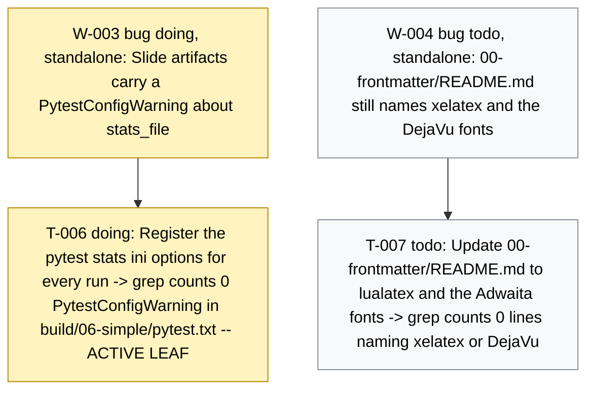

# Board -- chaos-to-simple
record: local
open path: W-003 > T-006   | blocked: 0 | todo roots: 1 | done: 8 | pruned: 0

## Tree

```text
W-003  bug    [doing]    (standalone) Slide artifacts carry a PytestConfigWarning about stats_file   (filed during T-004) -- T-006 [doing]   <- ACTIVE LEAF
W-004  bug    [todo]     (standalone) 00-frontmatter/README.md still names xelatex and the DejaVu fonts   (filed during T-004) -- T-007 [todo]
```

## Closed

### E-001 [done] Deck infrastructure: the drafts become one beamer PDF through make

closed 2026-10-30 -- outcome: make check proves the repository (board, ruff, pyright, pytest, ascii) and make deliverable writes build/talk.pdf from 00-frontmatter..07-close with every snippet, artifact and diagram built by make. -- ledger: ledgers/E-001.md

#### W-001 issue [done] The front door: base Makefile, python layer and the 3.14 toolchain

- T-001 [done] Write the base Makefile, the python layer and the 3.14 toolchain files -> make check prints [DONE] all checks passed
- T-002 [done] Move the helper tests beside their modules under the one-assert conftest -> make test M=model K=test_bars_follow_the_inventory passes

#### W-002 issue [done] The deck builds: mk/deck.mk, lualatex and the installed fonts

- T-003 [done] Add the diagram fallback helper scripts/utils/diagram.py with its edge test -> make test M=edge K=test_write_placeholder passes
- T-004 [done] Add mk/deck.mk with the deck targets, lualatex and the installed fonts -> make deliverable prints [DONE] deliverables built: deliverable-talk
- T-005 [done] Rewrite the README build section and add CLAUDE.md with the gate deviations -> grep finds ## Gate deviations in CLAUDE.md

## Diagram

