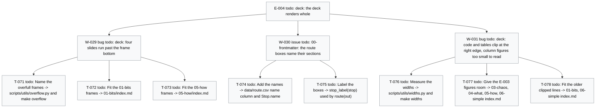

# Board -- chaos-to-simple
record: local
open path: none   | blocked: 0 | todo roots: 1 | done: 100 | pruned: 1

## Tree

```text
E-004         [todo]     deck: the deck renders whole
  W-029  bug    [todo]     deck: four slides run past the frame bottom   (filed during T-040) -- T-071 [todo], T-072 [todo], T-073 [todo]
  W-030  issue  [todo]     00-frontmatter: the route boxes name their sections   (filed during T-055) -- T-074 [todo], T-075 [todo]
  W-031  bug    [todo]     deck: code and tables clip at the right edge, column figures too small to read   (filed during T-070) -- T-076 [todo], T-077 [todo], T-078 [todo]
```

## Closed

### E-001 [done] Deck infrastructure: the drafts become one beamer PDF through make

closed 2026-10-30 -- outcome: make check proves the repository (board, ruff, pyright, pytest, ascii) and make deliverable writes build/talk.pdf from 00-frontmatter..07-close with every snippet, artifact and diagram built by make. -- ledger: ledgers/E-001.md

#### W-001 issue [done] The front door: base Makefile, python layer and the 3.14 toolchain

- T-001 [done] Write the base Makefile, the python layer and the 3.14 toolchain files -> make check prints [DONE] all checks passed
- T-002 [done] Move the helper tests beside their modules under the one-assert conftest -> make test M=model K=test_bars_follow_the_inventory passes

#### W-002 issue [done] The deck builds: mk/deck.mk, lualatex and the installed fonts

- T-003 [done] Add the diagram fallback helper scripts/utils/diagram.py with its edge test -> make test M=edge K=test_write_placeholder passes
- T-004 [done] Add mk/deck.mk with the deck targets, lualatex and the installed fonts -> make deliverable prints [DONE] deliverables built: deliverable-talk
- T-005 [done] Rewrite the README build section and add CLAUDE.md with the gate deviations -> grep finds ## Gate deviations in CLAUDE.md

### E-002 [done] The deck tells the storyline: past me, the cast of the ifs, three incidents closed by name

closed 2026-10-30 -- outcome: make talk builds a deck that runs from the message of past me to the six lines, with the cast, the incidents, the counts and the lines as artifacts the build measures or checks. -- ledger: ledgers/E-002.md

#### W-007 issue [done] 01-bits: the protagonist, the cast of the ifs and the count to 64

- T-010 [done] Add the cast data and its renderer -> build/01-bits/cast.txt
- T-011 [done] Rewrite the exhibit as past me left it -> test_chaos.py with his names, the I1 report
- T-012 [done] Add the two-ifs zoom-in -> build/01-bits/two_ifs.txt
- T-013 [done] Rewrite the 01 slides to the nine-slide format -> 01-bits/index.md, nine slides

#### W-008 issue [done] 00-frontmatter: the message from past me and the route

- T-014 [done] Draw the route -> build/00-frontmatter/route.png in the deck style
- T-015 [done] Rewrite the opening -> 00-frontmatter/index.md: message, raw code, chat, route

#### W-009 issue [done] 02-stacey: which problem do I have

- T-016 [done] Rewrite the 02 slides -> 02-stacey/index.md: instinct, matrix, map, route, the line

#### W-010 issue [done] 03-chaos: the room, the dispute decided and the honest count

- T-017 [done] Rewrite the red cards -> 03-chaos/data/questions.md with question 3 decided
- T-018 [done] Rewrite the 03 slides -> 03-chaos/index.md: room, six questions, effects, 512, table, line

#### W-011 issue [done] 04-what: the words become homes

- T-019 [done] Render the contexts with their faces -> build/04-what/contexts.txt
- T-020 [done] Rewrite the 04 slides -> 04-what/index.md: the sentence, homes with faces, the line

#### W-012 issue [done] 05-how: I3, the false victory and the seam

- T-021 [done] Write the I3 report -> 05-how/data/incident.txt
- T-022 [done] Rewrite the 05 slides -> 05-how/index.md: I3, the class, the hidden bit, CQS, seam, line

#### W-013 issue [done] 06-simple: the run of 72 and the seventh if

- T-023 [done] Add the seventh if beside the core, not inside it -> 06-simple/s06_simple/seventh.py
- T-028 [done] Render the epilogue counts -> build/06-simple/epilogue.txt
- T-029 [done] Rewrite the 06 slides -> 06-simple/index.md: core, 64, the wounds, 72, epilogue, line

#### W-014 issue [done] 07-close: the six lines

- T-024 [done] Rewrite the close -> 07-close/index.md: the six lines, where to go, Q&A
- T-025 [done] Check the lines against the sections -> scripts/check_lines.py, make lines

#### W-015 issue [done] build: the targets and filter behaviour the checks assume

- T-026 [done] Rename slides to talk, add K= to test, add the lines target -> Makefile, README.md
- T-027 [done] Number a snippet by its file line -> 00-frontmatter/filters/include-code-files.lua

#### W-016 issue [done] plots: one matplotlib and seaborn style for every chart and diagram

- T-030 [pruned] Add the deck style -> scripts/utils/style.py, applied by the stacked bar   [pruned: frozen Check '-> passes' compares the literal text and the run prints '4 passed'; the work stands in 734ef74 and closes under T-034]
- T-031 [done] Draw the Stacey matrix in Python -> build/02-stacey/stacey.png
- T-032 [done] Draw the story in Python -> build/03-chaos/story.png
- T-033 [done] Drop the Mermaid rule -> mk/deck.mk, README.md, CLAUDE.md without mmdc
- T-034 [done] Close the deck style on an exit-status Check -> scripts/utils/style.py at 734ef74

### E-003 [done] The talk runs one loop: found documents, built counts, figures in one style, the believed line flipped

closed 2026-10-31 -- outcome: make talk builds the deck with the five must and six should visuals of docs/storyline.md, each built from its source by make artifacts, and make lines checks a believed / learned pair per section. -- ledger: ledgers/E-003.md

#### W-018 issue [done] 06-simple: the wounds close by name in a run built from incidents.csv

- T-037 [done] Add the incidents -> data/incidents.csv and load_incidents
- T-038 [done] Select the wounds by name -> wounds_selector and scripts.paths wounds
- T-039 [done] Run the wounds -> build/06-simple/wounds.txt
- T-040 [done] Show the wounds -> 06-simple/index.md includes build/06-simple/wounds.txt

#### W-019 issue [done] 00-frontmatter, 01-bits, 05-how, 06-simple: the exhibits as found documents

- T-041 [done] Rewrite the I1 and I3 exhibits -> 01-bits/data/incident.txt, 05-how/data/incident.txt
- T-042 [done] Write the message and the teaser -> 00-frontmatter/data/message.txt, 06-simple/data/teaser.txt
- T-043 [done] Show the found documents -> 00-frontmatter/index.md, 01-bits/index.md, 06-simple/index.md

#### W-020 issue [done] 01-bits: the doubling with faces

- T-044 [done] Add the week -> data/cast.csv week column and CastRow.week
- T-045 [done] Render the doubling -> doubling_table and scripts.paths doubling
- T-046 [done] Show the doubling -> build/01-bits/doubling.txt on Count along

#### W-021 issue [done] lines: the believed / learned pair

- T-047 [done] Read the pair -> Line(section, believed, learned) and data/lines.csv
- T-048 [done] Put the believed lines on the slides -> NN-*/index.md and 07-close/index.md
- T-049 [done] Check the pair -> missing() names an absent believed line

#### W-022 issue [done] 01-bits: the two-if tree

- T-050 [done] Pin the leaves -> TREE_LEAVES in scripts/utils/figures.py
- T-051 [done] Draw the tree -> tree(out) and scripts.figures tree
- T-052 [done] Show the tree -> build/01-bits/tree.png on Four paths

#### W-023 issue [done] 00-frontmatter: the route on the map

- T-053 [done] Add the route -> data/route.csv and load_route
- T-054 [done] Place the route on the map -> route_layout(stops)
- T-055 [done] Show the map -> 00-frontmatter/section.mk and 02-stacey/index.md

#### W-024 issue [done] 03-chaos: what it felt like vs what it was

- T-056 [done] Count the growth -> growth(cast)
- T-057 [done] Draw the growth -> growth_chart(out, points) and scripts.paths growth
- T-058 [done] Show the growth -> build/03-chaos/growth.png before The honest count

#### W-025 issue [done] 04-what: the bits move, none deleted

- T-059 [done] Add the context palette -> context_colour(name) in scripts/utils/style.py
- T-060 [done] Count the moves -> moves(rules)
- T-061 [done] Draw the moves -> moves_figure(out, moves) and scripts.figures moves
- T-062 [done] Show the moves -> build/04-what/moves.png on Bounded contexts

#### W-026 issue [done] 03-chaos: the example map before and after the room

- T-063 [done] Count the cards -> card_counts in scripts/utils/examples.py
- T-064 [done] Draw the map -> example_map(out, before, after) and scripts.figures example-map
- T-065 [done] Show the map -> build/03-chaos/example_map.png on The six questions

#### W-027 issue [done] 05-how: the core and the shell with three ports

- T-066 [done] Read the ports -> ports_of(rules)
- T-067 [done] Draw the seam -> seam(out, ports) and scripts.figures seam
- T-068 [done] Show the seam -> 05-how/section.mk and The ports

#### W-028 issue [done] 06-simple: the epilogue as stacked bars

- T-069 [done] Build the two bars -> epilogue_bars(rules, seventh)
- T-070 [done] Show the bars -> build/06-simple/epilogue.png on the epilogue

### W-003 bug [done] (standalone) Slide artifacts carry a PytestConfigWarning about stats_file

closed 2026-10-30 -- outcome: Given a clean build/, When make deliverable runs, Then build/06-simple/pytest.txt holds no PytestConfigWarning line. -- ledger: ledgers/W-003.md

- T-006 [done] Register the pytest stats ini options for every run -> grep counts 0 PytestConfigWarning in build/06-simple/pytest.txt

### W-004 bug [done] (standalone) 00-frontmatter/README.md still names xelatex and the DejaVu fonts

closed 2026-10-30 -- outcome: Given 00-frontmatter/README.md, When grep -E 'xelatex|DejaVu' runs over it, Then it finds no line. -- ledger: ledgers/W-004.md

- T-007 [done] Update 00-frontmatter/README.md to lualatex and the Adwaita fonts -> grep counts 0 lines naming xelatex or DejaVu

### W-005 bug [done] (standalone) Slide artifacts carry the pytest slowest-durations block

closed 2026-10-30 -- outcome: Given a clean build/, When make deliverable runs, Then build/06-simple/pytest.txt holds no slowest durations line. -- ledger: ledgers/W-005.md

- T-008 [done] Drop the durations report from the two slide pytest recipes -> grep counts 0 slowest durations lines in build/06-simple/pytest.txt

### W-006 issue [done] (standalone) Slide pytest recipes repeat the pyproject addopts

closed 2026-10-30 -- outcome: Given the repository, When grep -c import-mode 01-bits/section.mk 06-simple/section.mk runs, Then it prints 0 for each file. -- ledger: ledgers/W-006.md

- T-009 [done] Keep the pytest options in pyproject only -> grep counts 0 import-mode lines in 06-simple/section.mk

### W-017 spike [done] (standalone) storyline: which of the developer's principles, data and ranked visuals the talk adopts

closed 2026-10-30 -- outcome: Given docs/storyline.md, When the developer reads its Plan section, Then it names the root, its work items and the conflicts with E-002 to decide. -- ledger: ledgers/W-017.md

- T-035 [done] Write the suggestions into the repository -> docs/storyline.md
- T-036 [done] Draft the root from the suggestions -> docs/storyline.md Plan section

## Diagram

