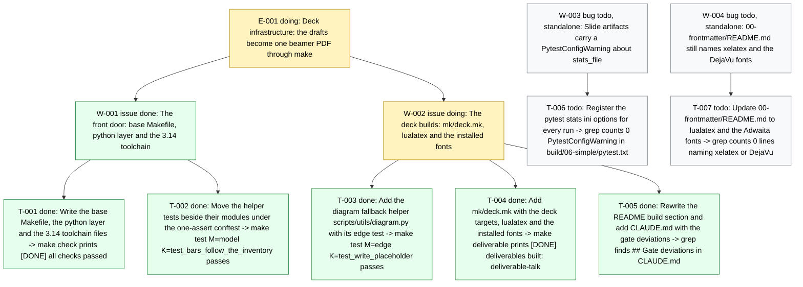

# Board -- chaos-to-simple
record: local
open path: E-001 > W-002   | blocked: 0 | todo roots: 2 | done: 6 | pruned: 0

## Tree

```text
E-001         [doing]    Deck infrastructure: the drafts become one beamer PDF through make
  W-001  issue  [done]     The front door: base Makefile, python layer and the 3.14 toolchain -- T-001 [done], T-002 [done]
  W-002  issue  [doing]    The deck builds: mk/deck.mk, lualatex and the installed fonts -- T-003 [done], T-004 [done], T-005 [done]
W-003  bug    [todo]     (standalone) Slide artifacts carry a PytestConfigWarning about stats_file   (filed during T-004) -- T-006 [todo]
W-004  bug    [todo]     (standalone) 00-frontmatter/README.md still names xelatex and the DejaVu fonts   (filed during T-004) -- T-007 [todo]
```

## Diagram

